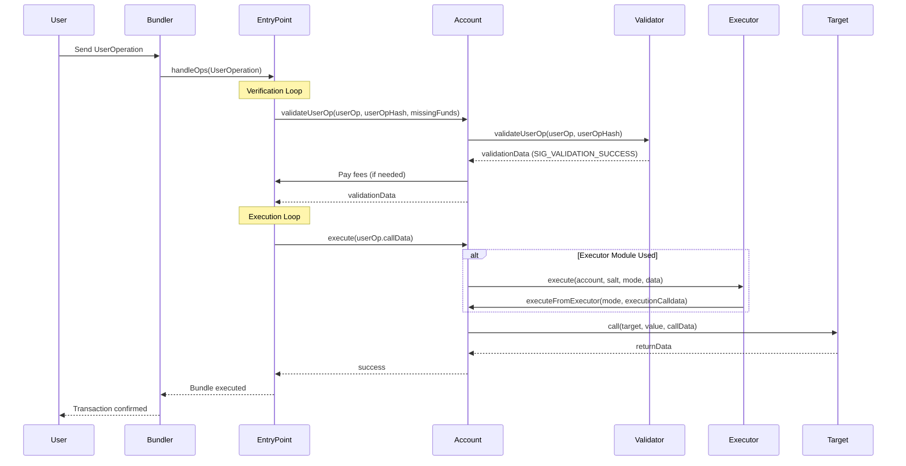

ERC-7579 (Minimal Modular Smart Accounts) is the standard that enables interoperability between smart accounts and modules across the ecosystem. This guide explains the key concepts you need to know when working with OpenZeppelin Accounts.

## What is ERC-7579?

ERC-7579 defines the minimal interfaces and behavior required for modular smart accounts and their modules to work together. The standard ensures that:

- **Modules work across different account implementations**: Write a module once, use it with Kernel, Safe, or any ERC-7579 account
- **Accounts work with any ERC-7579 module**: Install modules from different vendors without vendor lock-in
- **SDKs and tooling are interoperable**: Build tooling that works with all ERC-7579 accounts

The standard is intentionally minimal, allowing account vendors to innovate while ensuring basic interoperability.

### ERC-7579 + ERC-4337

ERC-7579 accounts integrate seamlessly with [ERC-4337](https://eips.ethereum.org/EIPS/eip-4337). The following sequence illustrates how a UserOperation flows through an ERC-7579 account with validator and executor modules:



<Callout>This flow assumes both the validator and executor modules are installed already</Callout>

In this flow:

1. **User sends UserOperation**: The user creates and signs a UserOperation, which is sent to a bundler
2. **Bundler calls EntryPoint**: The bundler packages UserOperations and calls `EntryPoint.handleOps()`
3. **Validation phase**: The EntryPoint calls `account.validateUserOp()`, which forwards to the installed validator module
4. **Validator verifies signature**: The validator module checks the signature and returns validation data
5. **Execution phase**: The EntryPoint calls `account.execute()` with the UserOperation's callData
6. **Optional executor**: If an executor module is used, it can execute operations on behalf of the account
7. **Target execution**: The account executes the actual operation (e.g., token transfer, contract call)
8. **Completion**: The EntryPoint refunds excess gas and the transaction is confirmed

<Callout type="idea">
Modules in ERC-7579 are not limited to use within the ERC-4337 flow.

- Validators could be invoked by calling `isValidSignature` on the target account using ERC-1271
- Executors may be called independently of the `EntryPoint` and without an `UserOperation` since they're designed to facilitate execution flows. You can call `executeFromExecutor` directly to execute from the account without involving the full ERC-4337 execution sequence.
- Fallback Handlers would be called whenever the account receives an unrecognized selector as part of the calldata.

</Callout>

## Core Concepts

### Smart Accounts

A **smart account** is a smart contract account with a modular architecture. ERC-7579 accounts can:

- Install and uninstall modules dynamically
- Execute operations through standardized interfaces
- Support multiple execution modes (single calls, batches, delegatecalls)
- Forward signature validation to validator modules

ERC-7579 accounts implement several core interfaces that expose an interface to get relevant information from the account, perform execution and configure modules:

```solidity
interface IERC7579ModuleConfig {
  /// @dev Installs a Module of a certain type on the smart account
  function installModule(uint256 moduleTypeId, address module, bytes calldata initData) external;

  /// @dev Uninstalls a Module of a certain type on the smart account
  function uninstallModule(uint256 moduleTypeId, address module, bytes calldata deInitData) external;

  /// @dev Returns whether a module is installed on the smart account
  function isModuleInstalled(
    uint256 moduleTypeId,
    address module,
    bytes calldata additionalContext
  ) external view returns (bool);
}

interface IERC7579Execution {
  /// @dev Executes a transaction on behalf of the account.
  function execute(bytes32 mode, bytes calldata executionCalldata) external payable;

  /// @dev Executes a transaction on behalf of the account.
  /// This function is intended to be called by Executor Modules
  function executeFromExecutor(
    bytes32 mode,
    bytes calldata executionCalldata
  ) external payable returns (bytes[] memory returnData);
}

interface IERC7579AccountConfig {
  /// @dev Returns a unique identifier for the account implementation, 
  /// typically structured as `"vendorname.accountname.semver"` (e.g., `"openzeppelin.openaccount.1.0"`).
  /// This helps SDKs and tooling identify the account type and version.
  function accountId() external view returns (string memory);

  /// @dev Checks whether the account supports a specific execution mode.
  /// Use this before executing operations to ensure compatibility.
  function supportsExecutionMode(bytes32 encodedMode) external view returns (bool);
  
  /// @dev Checks whether the account supports installing a specific module type.
  /// This allows you to verify module compatibility before attempting installation.
  function supportsModule(uint256 moduleTypeId) external view returns (bool);
}
```

### Modules

A **module** is a smart contract that provides self-contained functionality for a smart account. Modules come in different types:

- **Validators** (Type ID: 1): Determine if a transaction should be executed
- **Executors** (Type ID: 2): Execute transactions on behalf of the account
- **Fallback Handlers** (Type ID: 3): Extend the account's fallback functionality
- **Hooks** (Type ID: 4): Execute logic before/after operations

#### Module Lifecycle

Every module implements the core `IERC7579Module` interface:

```solidity
interface IERC7579Module {
  function onInstall(bytes calldata data) external;
  function onUninstall(bytes calldata data) external;
  function isModuleType(uint256 moduleTypeId) external view returns (bool);
}
```

When a module is installed:

1. The `installModule(moduleTypeId, module, initData)` function is called in the smart account.
2. The account calls `module.onInstall(initData)` to initialize the module
3. The account stores the module and its type

When uninstalled, the account calls `module.onUninstall(deInitData)` to clean up.

#### Building Custom Modules

The library provides composable abstract modules with an internal API for developers. A good starting point is [`ERC7579Validator`](/accounts/api/modules#ERC7579Validator) or [`ERC7579Executor`](/accounts/api/modules#ERC7579Executor), which include an opinionated base layer that combines with the other abstract modules. Hooks and fallback handlers are more straightforward to implement directly from their interfaces:

```solidity
import {IERC7579Module, IERC7579Hook} from "@openzeppelin/contracts/interfaces/draft-IERC7579.sol";
import {ERC7579Executor} from "@openzeppelin-accounts/contracts/modules/executors/ERC7579Executor.sol";
import {ERC7579Validator} from "@openzeppelin-accounts/contracts/modules/validators/ERC7579Validator.sol";

// Basic validator module
abstract contract MyValidator is ERC7579Validator {}

// Basic executor module
abstract contract MyExecutor is ERC7579Executor {}

// Basic fallback handler
abstract contract MyFallback is IERC7579Module {}

// Basic hook
abstract contract MyHook is IERC7579Hook {}
```

See the [Modules API reference](/accounts/api/modules) for the full set of abstract modules.

## Execution Modes

ERC-7579 uses a flexible execution mode system encoded in a `bytes32` value. The execution mode specifies:

| Field          | Size     | Description                                                                               |
| -------------- | -------- | ----------------------------------------------------------------------------------------- |
| `callType`     | 1 byte   | How to execute: `0x00` (call), `0x01` (batch), `0xfe` (staticcall), `0xff` (delegatecall) |
| `execType`     | 1 byte   | Error handling: `0x00` (revert on failure), `0x01` (continue on failure)                  |
| `unused`       | 4 bytes  | Reserved for future standardization                                                       |
| `modeSelector` | 4 bytes  | Custom mode selector for account-specific modes                                           |
| `modePayload`  | 22 bytes | Additional data for the execution mode                                                    |

### Execution Data Format

The execution data passed along with the mode depends on the call type:

- Single call: `abi.encodePacked(target, value, callData)`
- Batch call: `abi.encode(Execution[])`, where each `Execution` contains `target`, `value` and `callData`
- Delegate call: `abi.encodePacked(target, callData)`

### Single Call

Using OpenZeppelin's `ERC7579Utils` library:

```solidity
import {ERC7579Utils, Mode, ModeSelector, ModePayload} from "@openzeppelin/contracts/account/utils/draft-ERC7579Utils.sol";

using ERC7579Utils for *;

// Encode the execution mode and data
Mode mode = ERC7579Utils.encodeMode(
    ERC7579Utils.CALLTYPE_SINGLE,
    ERC7579Utils.EXECTYPE_DEFAULT,
    ModeSelector.wrap(0x00000000),
    ModePayload.wrap(0x00000000000000000000000000000000000000000000)
);
bytes memory executionData = ERC7579Utils.encodeSingle(target, value, callData);
account.execute(Mode.unwrap(mode), executionData);
```

Or using the SDK:

```typescript
import { encodeMode, encodeSingle, CALL_TYPE_CALL, EXEC_TYPE_DEFAULT } from '@openzeppelin-accounts/sdk';

const mode = encodeMode({
  callType: CALL_TYPE_CALL,
  execType: EXEC_TYPE_DEFAULT,
});
const executionData = encodeSingle(target, value, callData);
await account.write.execute([mode, executionData]);
```

### Batch Call

Using OpenZeppelin's `ERC7579Utils` library:

```solidity
import {ERC7579Utils, Mode, ModeSelector, ModePayload} from "@openzeppelin/contracts/account/utils/draft-ERC7579Utils.sol";
import {Execution} from "@openzeppelin/contracts/interfaces/draft-IERC7579.sol";

using ERC7579Utils for *;

// Prepare the execution batch
Execution[] memory executions = new Execution[](2);
executions[0] = Execution(target1, value1, callData1);
executions[1] = Execution(target2, value2, callData2);

// Encode the execution mode and data
Mode mode = ERC7579Utils.encodeMode(
    ERC7579Utils.CALLTYPE_BATCH,
    ERC7579Utils.EXECTYPE_DEFAULT,
    ModeSelector.wrap(0x00000000),
    ModePayload.wrap(0x00000000000000000000000000000000000000000000)
);
bytes memory executionData = ERC7579Utils.encodeBatch(executions);
account.execute(Mode.unwrap(mode), executionData);
```

Or using the SDK:

```typescript
import { encodeMode, encodeBatch, CALL_TYPE_BATCH, EXEC_TYPE_DEFAULT } from '@openzeppelin-accounts/sdk';

const mode = encodeMode({
  callType: CALL_TYPE_BATCH,
  execType: EXEC_TYPE_DEFAULT,
});
const executionData = encodeBatch(
  { target: target1, value: value1, callData: callData1 },
  { target: target2, value: value2, callData: callData2 },
);
await account.write.execute([mode, executionData]);
```

<Callout>
  The batching interface used in ERC-7579 is shared with [ERC-7802](https://eips.ethereum.org/EIP-7802), which defines a
  standard interface for crosschain token transfers. This shared format ensures consistency across different use cases
  and enables interoperability between standards.
</Callout>

Not all accounts support all execution modes. Check `supportsExecutionMode(mode)` before executing.
