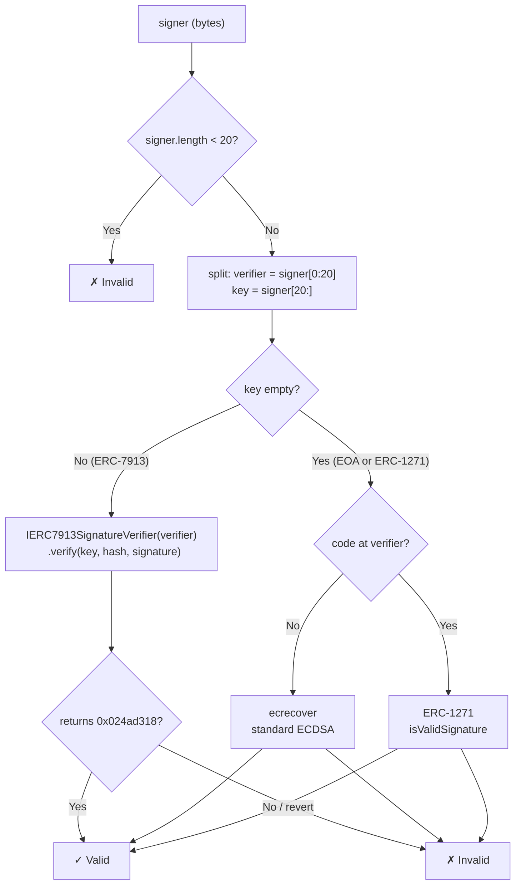

[ERC-7913](https://eips.ethereum.org/EIP-7913) extends the concept of signature verification beyond Ethereum addresses. While EOAs sign with secp256k1 and ERC-1271 contracts verify on behalf of a smart account, neither covers keys that have no Ethereum address of their own: P256 keys on a mobile device, a hardware security key, an email address. ERC-7913 introduces a unified interface so any cryptographic key type can be used as a signer without deploying a dedicated on-chain identity contract per key.

## Signer Representation

An ERC-7913 signer is a `bytes` object formed by concatenating a **verifier address** and an optional **key**:

```
signer = verifier (20 bytes) || key (0+ bytes)
```

| Signer length | Interpretation                          |
| ------------- | --------------------------------------- |
| < 20 bytes    | Invalid                                 |
| = 20 bytes    | `key` is empty → EOA or ERC-1271 contract at `verifier` |
| > 20 bytes    | `key` is non-empty → ERC-7913 verifier  |

This encoding is backward-compatible: a plain EOA address is a valid 20-byte signer (key empty, `verifier` is the EOA address itself).

## Verification Algorithm

Given a `signer`, a `hash`, and a `signature`, verification resolves as follows:



The ERC-7913 path calls a shared, stateless **verifier contract** that understands the encoding of a particular key type. Any number of keys of the same type share one verifier: no per-key deployment required.

## Verifier Interface

A verifier contract must implement:

```solidity
interface IERC7913SignatureVerifier {
    /**
     * @dev Verifies `signature` as a valid signature of `hash` by `key`.
     *
     * MUST return 0x024ad318 (verify.selector) if valid.
     * SHOULD return 0xffffffff or revert otherwise.
     */
    function verify(
        bytes calldata key,
        bytes32 hash,
        bytes calldata signature
    ) external view returns (bytes4);
}
```

Verifiers **should be stateless**, meaning that all parameters relevant to verification must be embedded in `key` or compiled into the verifier contract as immutables. This keeps verifiers permissionless, trustless, and compatible with the [ERC-7562](https://eips.ethereum.org/EIP-7562) storage access rules used in ERC-4337 validation.

## Signer Types

The table below shows how different key types are represented using the `verifier || key` encoding:

| Key type    | `verifier`                          | `key`                        |
| ----------- | ----------------------------------- | ---------------------------- |
| EOA         | EOA address                         | empty                        |
| ERC-1271    | contract address                    | empty                        |
| P256        | `P256Verifier` contract             | 64-byte `(qx, qy)`          |
| WebAuthn    | `WebAuthnVerifier` contract         | 64-byte `(qx, qy)`          |
| ZKEmail     | `ZKEmailVerifier` contract          | email-specific key bytes     |
| RSA         | `RSAVerifier` contract              | DER-encoded public key       |

OpenZeppelin Contracts ships a [`P256`](/contracts/5.x/api/utils/cryptography#P256) library and a [`WebAuthn`](/contracts/5.x/api/utils/cryptography#WebAuthn) library that can serve as the core of verifier contracts for those key types.

## In OpenZeppelin Accounts

ERC-7913 is leveraged by the [multisig base modules](/accounts/contracts/multisig) (`ERC7579Multisig`, `ERC7579MultisigWeighted`) to support heterogeneous signer sets. A single multisig can hold a mix of EOAs, P256 hardware keys, WebAuthn credentials, and ZKEmail addresses:

```solidity
bytes[] memory signers = new bytes[](3);
signers[0] = abi.encodePacked(alice);                               // EOA
signers[1] = abi.encodePacked(p256Verifier, qx, qy);               // P256
signers[2] = abi.encodePacked(zkEmailVerifier, emailKeyBytes);      // ZKEmail
```

The `ERC7579SocialRecoveryExecutor` and the multisig validators all consume signers in this format. See [Base Modules](/accounts/contracts/multisig) and [Validators](/accounts/contracts/validators) for usage details.

## Security Considerations

- **Verifiers must be trustless**: because signers may be configured years before they are used (e.g., social recovery guardians), a verifier that is upgradeable or depends on mutable state could be compromised. Verifiers should be immutable contracts.
- **Verifiers should be stateless**: the `verify` function should behave like a `pure` function. All verification parameters come from `key` or hardcoded logic. This also ensures compliance with ERC-4337's storage access restrictions during UserOperation validation.
