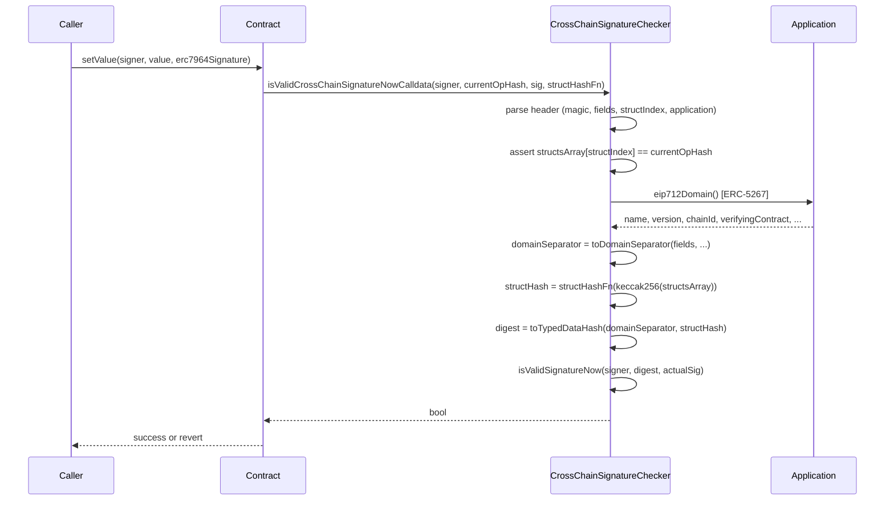

import { Step, Steps } from 'fumadocs-ui/components/steps';

[ERC-7964](https://eips.ethereum.org/EIPS/eip-7964) enables a single EIP-712 signature to be valid across multiple chains simultaneously. Rather than asking users to sign one message per chain, it omits `chainId` from the top-level domain and encodes chain-specific operations as an array of nested structs (one per chain), so wallets display all authorized operations in a single, fully human-readable signing prompt.

## Background

Interacting with a chain requires the signature of a private key to validate the account's identity. Natively, the EVM supports ECDSA signature validation for EOAs, while smart accounts often validate signatures using [ERC-1271](https://eips.ethereum.org/EIPS/eip-1271) to provide a `hash` and a `bytes` buffer representing the signature to be validated.

Smart contracts are able to execute functionality on behalf of the signing account by validating the signature. In fact, this approach is commonly used by applications to enable operations without requiring the signing account to execute a transaction.

In practice, signing a simple Ethereum message is not enough for more complex applications that require structured data to be represented by the signature while still being readable for the end user. To solve this, [EIP-712](https://eips.ethereum.org/EIPS/eip-712) standardizes signing messages whose content is a struct of values that can be used by the EVM. Each message is bound to a `domainSeparator` hash by design, which includes the `verifyingContract` and a `chainId` to avoid replayability attacks (i.e., the same signature used in different chains or contracts).

### Selective Replayability

As a consequence of the EIP-712 domain, to coordinate signatures across different chains applications must decide whether they ask users to sign one EIP-712 message per chain to preserve readability (degrading UX), or request a single signature with a different encoding scheme, sacrificing readability and introducing trust assumptions on the UI that requests the signature.

Ideally, users should sign a single human-readable message that is selectively replayable in certain domains to preserve security. Fortunately, EIP-712 has the following properties:

- All domain fields are optional and can be omitted at convenience, enabling developers to create signatures that are not bound by either `chainId` or `verifyingContract` and can be reused in a different chain.
- Nested structs are supported

### How ERC-7964 Works

ERC-7964 omits `chainId` and `verifyingContract` from the outer domain and instead encodes them inside a `ChainOperation` struct that also carries the chain-specific parameters:

```solidity
ChainOperation(EIP712ChainDomain domain,...)
EIP712ChainDomain(uint256 chainId,address verifyingContract)
```

Per EIP-712, arrays are encoded as `keccak256(encodeData(element[0]) ‖ encodeData(element[1]) ‖ ... ‖ encodeData(element[n]))` and structs are hashed as `hashStruct(s : 𝕊) = keccak256(typeHash ‖ encodeData(s))`. This means that an array of structs would be encoded as `keccak256(hashStruct(s0) ‖ hashStruct(s1) ‖ ... ‖ hashStruct(sn))`. Therefore, an array of structs that represent chain-specific operations would look like the following:

```solidity
// Each operation is hashed individually
operationHashes = [
  keccak256(abi.encode(CHAIN_OPERATION_TYPEHASH, chainDomainHash0, ...)),
  keccak256(abi.encode(CHAIN_OPERATION_TYPEHASH, chainDomainHash1, ...)),
  keccak256(abi.encode(CHAIN_OPERATION_TYPEHASH, chainDomainHash2, ...)),
  // ...
]

// The array hash is computed by concatenating all operation hashes
operationsArrayHash = keccak256(abi.encodePacked(operationHashes))

// The main struct hash uses the array hash
mainStructHash = keccak256(abi.encode(CROSS_CHAIN_OPERATION_TYPEHASH, operationsArrayHash))
```

Smart contracts that support this signature verification scheme request the user to sign an EIP-712 type that includes all the operations that the signature enables without requiring special wallet support. During verification, the smart contract receives only the operation relevant to it and the array of operation hashes (i.e., not the full list of structs) to reconstruct the final signed hash.

While several solutions exist for enabling crosschain signatures, ERC-7964 provides **full transparency**. Users see all chain operations in any EIP-712 compatible wallet without custom support, prioritizing readability, security and widespread wallet compatibility.

## Signature Encoding and Verification

Smart contracts must be able to include metadata to reconstruct the final type hash and detect when a signature is intended for crosschain validation. To solve this, ERC-7964 defines a standard encoding that packs all metadata into the leading 32 bytes of the signature:

```solidity
bytes9  ERC7964_MAGIC = 0x796479647964796479; // bytes 0–8
bytes1  fields        = 0x03;                  // byte 9   (ERC-5267 domain field flags)
uint16  structIndex   = <...>;                 // bytes 10–11 (index of this chain's operation)
address application   = 0x...;                 // bytes 12–31 (ERC-5267 provider for the domain)

bytes32 header = bytes32(abi.encodePacked(ERC7964_MAGIC, fields, structIndex, application));

bytes memory erc7964Signature = abi.encode(header, structsArray, actualSignature);
```

The `fields` byte follows [ERC-5267](https://eips.ethereum.org/EIPS/eip-5267): each bit signals which domain fields (`name`, `version`, `chainId`, `verifyingContract`, `salt`) the domain separator includes. The `application` address is queried at verification time via `IERC5267.eip712Domain()` to reconstruct the chain-specific domain separator on the fly.

The `CrossChainSignatureChecker` library provides utilities for parsing and verifying ERC-7964 signatures in your contracts. The full verification sequence is:



## Writing Crosschain Applications

Smart contracts can support ERC-7964 signatures using the `CrossChainSignatureChecker` library. Here's how to implement an application that accepts crosschain signatures:

<Steps>
<Step>
### Define Your Type Hashes

First, define the type hashes for your message structures. You'll need:

1. A type hash for the chain-specific domain (including `chainId`)
2. A type hash for each chain operation struct
3. A type hash for the main crosschain struct (wrapping the operations array)

```solidity
import { EIP712 } from '@openzeppelin/contracts/utils/cryptography/EIP712.sol';
import { CrossChainSignatureChecker } from '@openzeppelin-accounts/contracts/utils/CrossChainSignatureChecker.sol';

contract CrossChainApp is EIP712 {
  using CrossChainSignatureChecker for address;

  // Chain-specific domain type hash (includes chainId)
  bytes32 public constant EIP712_CHAIN_DOMAIN_TYPEHASH =
    keccak256('EIP712ChainDomain(uint256 chainId,address verifyingContract)');

  // Chain operation type hash (includes nested EIP712ChainDomain type)
  bytes32 public constant CHAIN_OPERATION_TYPEHASH =
    keccak256(
      'ChainOperation(EIP712ChainDomain domain,uint256 value)EIP712ChainDomain(uint256 chainId,address verifyingContract)'
    );

  // Main crosschain struct type hash (includes all nested types)
  bytes32 public constant CROSS_CHAIN_SET_VALUE_TYPEHASH =
    keccak256(
      'SetValue(ChainOperation[] operations)ChainOperation(EIP712ChainDomain domain,uint256 value)EIP712ChainDomain(uint256 chainId,address verifyingContract)'
    );

  constructor(string memory name, string memory version) EIP712(name, version) {}
}
```

</Step>

<Step>
### Implement Struct Hash Functions

Implement functions to compute the struct hash for the current chain's operation and the main crosschain struct:

```solidity
function _structHash(uint256 value_) internal view returns (bytes32) {
  bytes32 chainDomainHash = keccak256(abi.encode(EIP712_CHAIN_DOMAIN_TYPEHASH, block.chainid, address(this)));
  return keccak256(abi.encode(CHAIN_OPERATION_TYPEHASH, chainDomainHash, value_));
}

function _crossChainStructHash(bytes32 operationsHash) internal pure returns (bytes32) {
  return keccak256(abi.encode(CROSS_CHAIN_SET_VALUE_TYPEHASH, operationsHash));
}
```

The `_structHash` function computes the hash of the current chain's operation, including the `chainId` and `verifyingContract` in the chain domain. The `_crossChainStructHash` function computes the hash of the main crosschain struct, which wraps the array of operations.

</Step>

<Step>
### Verify Signatures

Use `CrossChainSignatureChecker` to verify signatures. The library provides two variants: one that takes `bytes memory` and one that takes `bytes calldata` (more gas-efficient):

```solidity
function setValue(address account, uint256 value_, bytes calldata erc7964Signature) public {
  bytes32 currentOpHash = _structHash(value_);

  require(
    account.isValidCrossChainSignatureNowCalldata(currentOpHash, erc7964Signature, _crossChainStructHash),
    'Invalid signature'
  );

  // Execute the operation
  _setValue(account, value_);
}
```

The `isValidCrossChainSignatureNowCalldata` function:

1. Parses the ERC-7964 signature encoding to extract metadata (struct index, application address, array of struct hashes)
2. Verifies that the provided `currentOpHash` matches the struct at the correct index in the array
3. Queries the application contract (via ERC-5267) for the EIP-712 domain information
4. Reconstructs the full typed hash using the domain and the array of struct hashes
5. Validates the signature against the reconstructed hash

</Step>

</Steps>

## Complete Example

Here's a complete example that puts it all together:

```solidity
// SPDX-License-Identifier: MIT
pragma solidity ^0.8.24;

import { EIP712 } from '@openzeppelin/contracts/utils/cryptography/EIP712.sol';
import { CrossChainSignatureChecker } from '@openzeppelin-accounts/contracts/utils/CrossChainSignatureChecker.sol';

contract CrossChainApp is EIP712 {
  using CrossChainSignatureChecker for address;

  bytes32 public constant EIP712_CHAIN_DOMAIN_TYPEHASH =
    keccak256('EIP712ChainDomain(uint256 chainId,address verifyingContract)');
  bytes32 public constant CHAIN_OPERATION_TYPEHASH =
    keccak256(
      'ChainOperation(EIP712ChainDomain domain,uint256 value)EIP712ChainDomain(uint256 chainId,address verifyingContract)'
    );
  bytes32 public constant CROSS_CHAIN_SET_VALUE_TYPEHASH =
    keccak256(
      'SetValue(ChainOperation[] operations)ChainOperation(EIP712ChainDomain domain,uint256 value)EIP712ChainDomain(uint256 chainId,address verifyingContract)'
    );

  mapping(address account => uint256) private _values;

  constructor(string memory name, string memory version) EIP712(name, version) {}

  function value(address account) public view returns (uint256) {
    return _values[account];
  }

  function setValue(address account, uint256 value_, bytes calldata erc7964Signature) public {
    bytes32 currentOpHash = _structHash(value_);

    require(
      account.isValidCrossChainSignatureNowCalldata(currentOpHash, erc7964Signature, _crossChainStructHash),
      'Invalid signature'
    );

    _values[account] = value_;
  }

  function _crossChainStructHash(bytes32 operationsHash) internal pure returns (bytes32) {
    return keccak256(abi.encode(CROSS_CHAIN_SET_VALUE_TYPEHASH, operationsHash));
  }

  function _structHash(uint256 value_) internal view returns (bytes32) {
    bytes32 chainDomainHash = keccak256(abi.encode(EIP712_CHAIN_DOMAIN_TYPEHASH, block.chainid, address(this)));
    return keccak256(abi.encode(CHAIN_OPERATION_TYPEHASH, chainDomainHash, value_));
  }
}
```

<Callout>OpenZeppelin's EIP712 contract already implements ERC-5267, so it can be passed directly as the `application` address in the signature header.</Callout>

## Message Structure for Users

When users sign crosschain messages, the EIP-712 structure should look like this:

```javascript
{
  types: {
    EIP712Domain: [
      { name: "name", type: "string" },
      { name: "version", type: "string" }
      // chainId is omitted for crosschain validity
    ],
    SetValue: [
      { name: "operations", type: "ChainOperation[]" }
    ],
    ChainOperation: [
      { name: "domain", type: "EIP712ChainDomain" },
      { name: "value", type: "uint256" }
    ],
    EIP712ChainDomain: [
      { name: "chainId", type: "uint256" },
      { name: "verifyingContract", type: "address" }
    ]
  },
  primaryType: "SetValue",
  domain: {
    name: "CrossChainApp",
    version: "1"
  },
  message: {
    operations: [
      {
        domain: { chainId: 1, verifyingContract: "0x..." },
        value: 42
      },
      {
        domain: { chainId: 42161, verifyingContract: "0x..." },
        value: 42
      }
    ]
  }
}
```

The operations array encodes to a single `bytes32` hash per EIP-712, and users can see all operations in their wallet. Each chain validates only its relevant operation from the signature.

## In OpenZeppelin Accounts

`CrossChainSignatureChecker` is a standalone library that any contract can import. It is used by the included ERC-7579 validators to support ERC-7964 signatures natively, so smart account users can authorize operations on multiple chains with a single signature through their installed validator.

See [Validators](/accounts/contracts/validators) for usage details.

## Security Considerations

### Signature Replay

ERC-7964 intentionally enables replay across chains, the same signature is designed to be used on multiple chains. The `verifyingContract` field inside each `ChainOperation` binds that operation to a specific contract address, but the outer signature itself has no chain binding. Applications must implement their own replay protection mechanisms such as including nonces and deadlines in the chain-specific operation struct.

### Partial Execution

Crosschain signatures do not guarantee atomic execution across chains. A signature may be successfully validated on some chains but not others, resulting in partial fulfillment. Applications that require atomicity should implement complementary mechanisms such as refund paths or escrow patterns to allow users to recover from failed partial executions.

### Verifier Trust

The `application` address embedded in the signature header is queried at verification time via `IERC5267.eip712Domain()` to reconstruct the domain separator. If the contract at that address is upgradeable or mutable, it could return a different domain on a later call, potentially allowing a signature to verify against an unintended domain. Prefer immutable contracts as the `application` address, or validate that the returned domain matches the expected values before accepting the signature.
