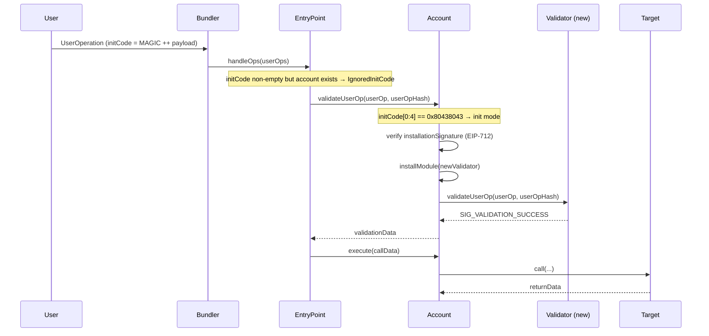

import { Step, Steps } from 'fumadocs-ui/components/steps';

[ERC-8043](https://eips.ethereum.org/EIP-8043) (Atomic ERC-7579 Module Install and Execute) solves a common friction point in modular smart accounts: having to send two separate user operations: one to install a module and another to use it. Init mode collapses both into one by piggybacking on the `initCode` field of an ERC-4337 user operation.

## How It Works

[ERC-4337](https://eips.ethereum.org/EIPS/eip-4337) EntryPoint v0.9 introduced a subtle but powerful behavior: when `initCode` is non-empty but the sender account is **already deployed**, the EntryPoint silently skips the factory call and emits an `IgnoredInitCode` event. Crucially, `initCode` is still included in the `userOpHash` computation, so its contents are cryptographically committed to by the user operation signature.

ERC-8043 exploits this: a 4-byte magic value at the start of `initCode` signals the account to enter _init mode_ during validation, decode the payload, verify the installation authorization, install the modules, and then continue with normal user operation validation.



In this flow:

1. The user bundles module installation data into `initCode` alongside the 4-byte magic value
2. The EntryPoint ignores `initCode` (account already exists) but keeps it in the hash
3. The account detects the magic, decodes the payload, and validates the EIP-712 `installationSignature`
4. Modules are installed, and the user operation proceeds with normal validation through the newly installed module

## The Magic Value

Init mode is triggered when the first 4 bytes of `userOp.initCode` equal:

```solidity
bytes4 constant INIT_MODE_MAGIC_VALUE = 0x80438043;
```

The value `0x8043` embeds the ERC number for self-documentation. A 4-byte prefix is sufficient because a valid init mode `initCode` payload is always far longer than 20 bytes—: he minimum ABI-encoded `(uint256[], address[], bytes[], bytes)` is 256 bytes (four 32-byte head offsets plus four 32-byte length words), so there is no ambiguity with a real factory address.

<Callout>
  The EntryPoint v0.9 only ignores `initCode` for **already-deployed** accounts. Bundlers will reject a user operation
  with non-empty `initCode` for an undeployed account if the factory address is not a valid factory. ERC-8043 applies
  exclusively to accounts that are already deployed.
</Callout>

## `initCode` Encoding Format

The bytes after the magic value (`userOp.initCode[4:]`) are ABI-encoded as:

```solidity
abi.encode(
    uint256[] moduleTypeIds,
    address[] modules,
    bytes[]   initDatas,
    bytes     installationSignature
)
```

| Field                   | Type        | Description                                                 |
| ----------------------- | ----------- | ----------------------------------------------------------- |
| `moduleTypeIds`         | `uint256[]` | ERC-7579 module type identifier for each module             |
| `modules`               | `address[]` | Address of each module to install                           |
| `initDatas`             | `bytes[]`   | Initialization data passed to each module's `onInstall`     |
| `installationSignature` | `bytes`     | EIP-712 signature authorizing the installations (see below) |

All three arrays must have the same length. Passing an empty `installationSignature` skips both signature verification and module installation, allowing the user operation to proceed with normal validation only.

## EIP-712 Installation Authorization

The `installationSignature` is an [EIP-712](https://eips.ethereum.org/EIPS/eip-712) signature over the following typed struct, using the **account's own domain separator**:

```solidity
bytes32 constant INIT_MODULES_TYPEHASH = keccak256(
  'InitModules(uint256[] moduleTypeIds,address[] modules,bytes[] initDatas,uint256 nonce)'
);
```

The struct hash is computed as:

```solidity
bytes32 structHash = keccak256(abi.encode(
    INIT_MODULES_TYPEHASH,
    keccak256(abi.encodePacked(moduleTypeIds)),
    keccak256(abi.encodePacked(modules)),
    keccak256(abi.encodePacked(initDataHashes)), // element-by-element keccak256 of each bytes
    userOp.nonce
));
```

The account verifies it using its own `isValidSignature`, which routes the signature to the currently installed validator:

```solidity
isValidSignature(_hashTypedDataV4(structHash), installationSignature)
```

### Why EIP-712?

EIP-712 lets hardware wallets and browser signers display exactly which modules at which addresses are being authorized, with what initialization data, and at which nonce. This separates the owner's **installation authorization** (what modules are being granted access to this account) from the **execution authorization** (who signs the user operation itself, e.g. a session key that is being installed in the same operation).

### Replay Protection

The `userOp.nonce` is included in the `InitModules` struct. Once the user operation is executed and its nonce consumed, the same `installationSignature` cannot be replayed. The EIP-712 domain separator binds the signature to the specific account address and chain ID.

## Validation Flow

The full init mode validation flow implemented by `AccountERC8043Upgradeable`:

<Steps>

<Step>
**Detect init mode**

Check whether `userOp.initCode` starts with the magic value. If not, fall through to normal `_validateUserOp`.

```solidity
if (userOp.initCode.length >= 4 && bytes4(userOp.initCode[:4]) == ERC8043Utils.INIT_MODE_MAGIC_VALUE) {
    // ...decode, verify, and install (steps below)...
}
return super._validateUserOp(userOp, userOpHash, signature);
```

</Step>

<Step>
**Decode the payload**

Decode `(moduleTypeIds, modules, initDatas, installationSignature)` from `userOp.initCode[4:]`. Return `SIG_VALIDATION_FAILED` on any decoding error or array length mismatch.

</Step>

<Step>
**Verify the installation signature**

Compute the EIP-712 struct hash and validate `installationSignature` via `isValidSignature`. If the signature is empty, skip this step and proceed without installing any modules.

```solidity
bytes32 structHash = ERC8043Utils.initModulesStructHash(moduleTypeIds, modules, initDatas, userOp.nonce);
if (isValidSignature(_hashTypedDataV4(structHash), installationSignature) != IERC1271.isValidSignature.selector) {
    return ERC4337Utils.SIG_VALIDATION_FAILED;
}
```

</Step>

<Step>
**Install modules**

Call `_installModule` for each `(moduleTypeId, module, initData)` tuple.

```solidity
for (uint256 i = 0; i < modules.length; i++) {
    _installModule(moduleTypeIds[i], modules[i], initDatas[i]);
}
```

</Step>

<Step>
**Delegate to normal validation**

Continue with `super._validateUserOp` using the forwarded `signature`. This validates the user operation itself through the appropriate installed validator (e.g. the one just installed).

```solidity
return super._validateUserOp(userOp, userOpHash, signature);
```

</Step>

</Steps>

## Using `AccountERC8043Upgradeable`

`AccountERC8043Upgradeable` is an abstract extension of `AccountERC7579Upgradeable`. It is already included in `OpenAccountImplementation`, the contract deployed by [`OpenAccountFactory`](/accounts/contracts#using-openaccountfactory), so every account created through the factory supports init mode out of the box with no extra setup.

### Building an Init Mode User Operation

The steps below show how to build a user operation that installs a new validator and uses it in the same operation.

<Steps>

<Step>
**Compute the EIP-712 installation signature**

```solidity
bytes32[] memory initDataHashes = new bytes32[](1);
initDataHashes[0] = keccak256(initData);

bytes32 structHash = keccak256(abi.encode(
    INIT_MODULES_TYPEHASH,
    keccak256(abi.encodePacked(moduleTypeIds)),
    keccak256(abi.encodePacked(modules)),
    keccak256(abi.encodePacked(initDataHashes)),
    nonce
));

bytes32 digest = MessageHashUtils.toTypedDataHash(accountDomainSeparator, structHash);
(uint8 v, bytes32 r, bytes32 s) = vm.sign(ownerPrivateKey, digest);

// Prefix with the validator module address for ERC-7579 isValidSignature routing
bytes memory installationSignature = abi.encodePacked(address(currentValidator), r, s, v);
```

</Step>

<Step>
**Encode `initCode`**

```solidity
uint256[] memory moduleTypeIds = new uint256[](1);
moduleTypeIds[0] = MODULE_TYPE_VALIDATOR;
address[] memory modules = new address[](1);
modules[0] = address(newValidator);
bytes[] memory initDatas = new bytes[](1);
initDatas[0] = abi.encodePacked(newValidatorSigner);

bytes memory initCode = abi.encodePacked(
    bytes4(0x80438043),                                             // INIT_MODE_MAGIC_VALUE
    abi.encode(moduleTypeIds, modules, initDatas, installationSignature)
);
```

</Step>

<Step>
**Build and sign the user operation**

Route the nonce through the newly installed validator (upper 160 bits = validator address) and sign `userOpHash` with the new validator's key:

```solidity
uint256 nonce = uint256(uint160(address(newValidator))) << 96;

PackedUserOperation memory userOp = PackedUserOperation({
    sender:   address(account),
    nonce:    nonce,
    initCode: initCode,
    // ... callData, gas fields, etc.
    signature: bytes("") // filled in after hashing
});

bytes32 userOpHash = entryPoint.getUserOpHash(userOp);
(uint8 v, bytes32 r, bytes32 s) = vm.sign(newValidatorPrivateKey, userOpHash);
userOp.signature = abi.encodePacked(r, s, v);
```

</Step>

<Step>
**Submit**

```solidity
PackedUserOperation[] memory ops = new PackedUserOperation[](1);
ops[0] = userOp;
entryPoint.handleOps(ops, payable(beneficiary));
```

After execution, the new module is installed and the call in `callData` has been executed, all in one user operation.

</Step>

</Steps>

### Installing Multiple Modules

Init mode supports installing any number of modules atomically. Pass parallel arrays with one entry per module:

```solidity
uint256[] memory moduleTypeIds = new uint256[](3);
moduleTypeIds[0] = MODULE_TYPE_VALIDATOR;
moduleTypeIds[1] = MODULE_TYPE_VALIDATOR;
moduleTypeIds[2] = MODULE_TYPE_EXECUTOR;

address[] memory modules    = new address[](3);
bytes[]   memory initDatas  = new bytes[](3);
// ... populate each entry ...

bytes memory initCode = abi.encodePacked(
    bytes4(0x80438043),
    abi.encode(moduleTypeIds, modules, initDatas, installationSignature)
);
```

Modules are installed in array order. If any installation reverts, the entire user operation fails.

## Security Considerations

- **EntryPoint version**: Init mode requires EntryPoint **v0.9** (`0x433709009B8330FDa32311DF1C2AFA402eD8D009`). On earlier versions, non-empty `initCode` for an already-deployed account is rejected by bundlers.
- **`IgnoredInitCode` event**: The v0.9 EntryPoint emits `IgnoredInitCode` for every init mode user operation. Monitoring tools should not treat this event as an anomaly.
- **Empty `installationSignature`**: Passing an empty signature skips module installation entirely. The user operation still proceeds with normal validation. This is useful for no-op init mode triggers but does not install any modules.
