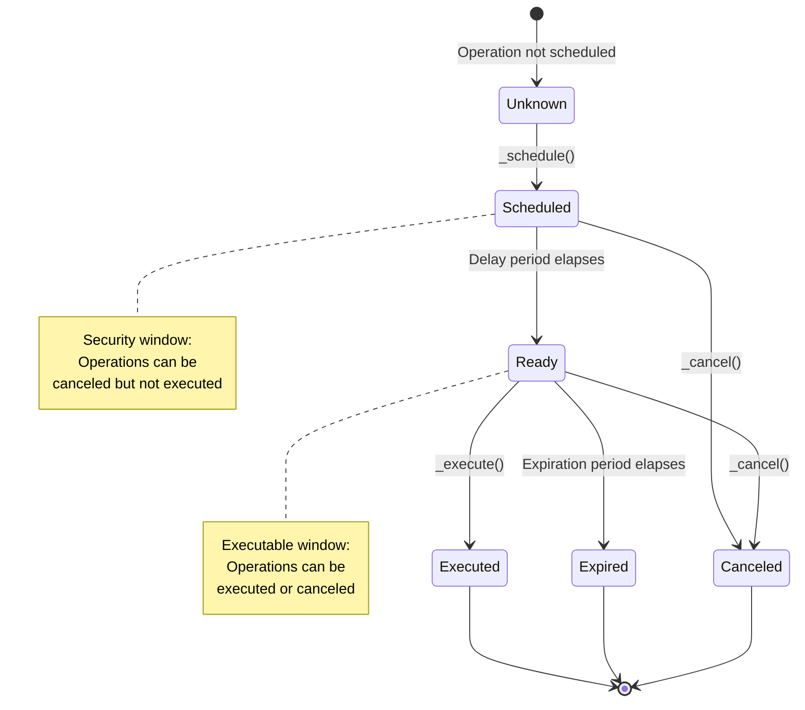

Executor modules enable accounts to execute operations through a callback mechanism. Unlike direct execution, executors call `executeFromExecutor` on the account, allowing for additional validation, scheduling, and access control logic.

## Base Executor

**`ERC7579Executor`** is the abstract base contract for all executor modules. It provides:

- Core execution functionality via the internal `_execute` function
- Integration with ERC-7579's `executeFromExecutor` interface
- Full flexibility for implementing custom validation and access control

Developers extending this base contract must implement:

- `onInstall(bytes calldata data)`: Initialize the executor with account-specific configuration
- `onUninstall(bytes calldata data)`: Clean up executor state
- A public `execute` function (or similar) that implements validation logic and calls `_execute`

## Available Executors

OpenZeppelin Accounts provides the following executor implementations:

### ERC7579DelayedExecutor

An executor base contract that provides scheduling infrastructure for time-delayed execution with expiration. Operations are scheduled and must wait for a delay period before becoming executable. This provides a security window to cancel suspicious operations.

Developers must implement their own `schedule`, `cancel`, and `execute` functions with appropriate validation and access control logic, then call the internal `_schedule`, `_cancel`, and `_execute` functions.

**Key Features:**

- Internal functions for scheduling (`_schedule`, `_scheduleAt`) and cancellation (`_cancel`)
- Time-delayed execution with configurable delay periods
- Expiration mechanism (operations expire if not executed in time)
- Security window for canceling operations
- Operation state tracking (Unknown, Scheduled, Ready, Expired, Executed, Canceled)
- Full flexibility for custom validation and access control

**Operation Lifecycle:**



<Callout>
This is an abstract contract. You need to create a concrete implementation:

```solidity
contract MyDelayedExecutor is ERC7579DelayedExecutor {
  function schedule(
    address account,
    bytes32 salt,
    bytes32 mode,
    bytes calldata data
  ) public {
    // Implement authorization logic for scheduling
    // e.g., require(msg.sender == account, "unauthorized");
    
    // Call the internal _schedule function
    _schedule(account, salt, mode, data);
  }

  function cancel(
    address account,
    bytes32 salt,
    bytes32 mode,
    bytes calldata data
  ) public {
    // Implement authorization logic for canceling
    // e.g., require(msg.sender == account, "unauthorized");
    
    // Call the internal _cancel function
    _cancel(account, salt, mode, data);
  }

  function execute(
    address account,
    bytes32 salt,
    bytes32 mode,
    bytes calldata data
  ) public returns (bytes[] memory) {
    // Optionally implement authorization logic for execution
    // Note: _execute already checks that the operation is Ready
    
    // Call the internal _execute function
    return _execute(account, salt, mode, data);
  }
}
```

</Callout>

To install an ERC7579DelayedExecutor:

```solidity
import {MODULE_TYPE_EXECUTOR} from "@openzeppelin/contracts/interfaces/draft-IERC7579.sol";
import {ERC7579DelayedExecutor} from "@openzeppelin-accounts/contracts/modules/executors/ERC7579DelayedExecutor.sol";

// Create a concrete dummy implementation
// WARNING: Do not use in production since it doesn't implement access control
contract MyDelayedExecutor is ERC7579DelayedExecutor {
    function schedule(
        address account,
        bytes32 salt,
        bytes32 mode,
        bytes calldata data
    ) public {
        // No access control for educational purposes.
        _schedule(account, salt, mode, data);
    }

    function cancel(
        address account,
        bytes32 salt,
        bytes32 mode,
        bytes calldata data
    ) public {
        // No access control for educational purposes.
        _cancel(account, salt, mode, data);
    }

    function execute(
        address account,
        bytes32 salt,
        bytes32 mode,
        bytes calldata data
    ) public returns (bytes[] memory) {
        // No access control for educational purposes.
        return _execute(account, salt, mode, data);
    }
}

// Deploy the executor
MyDelayedExecutor executor = new MyDelayedExecutor();

// Prepare initialization data: delay (4 bytes) + expiration (4 bytes)
uint32 delay = 7 days; // Operations must wait 7 days before execution
uint32 expiration = 30 days; // Operations expire 30 days after becoming ready
bytes memory initData = abi.encodePacked(delay, expiration);

// Install the module
account.installModule(MODULE_TYPE_EXECUTOR, address(executor), initData);
```

To schedule a delayed operation, provide a unique `salt`, the `mode`, and the `executionData`. Scheduling registers the operation and enforces the configured delay before it can be executed.

```solidity
// Generate a salt (unique identifier for this operation)
bytes32 salt = keccak256("recovery-operation");
bytes32 mode = /* ERC-7579 execution mode */;
bytes calldata executionData = /* calldata to execute the operation */;

// Schedule the operation
executor.schedule(address(account), salt, mode, executionData);
```

You can check the current state of the scheduled operation and retrieve timestamps:

```solidity
// Query the state of the operation
ERC7579DelayedExecutor.OperationState operationState =
    executor.state(address(account), salt, mode, executionData);
// State will be one of: Unknown, Scheduled, Ready, Expired, Executed, or Canceled

// Get timestamps for scheduled, executable, and expiration times
(uint48 scheduledAt, uint48 executableAt, uint48 expiresAt) =
    executor.getSchedule(address(account), salt, mode, executionData);
```

Once the delay has elapsed and the state becomes `Ready`, you can execute the scheduled operation. Attempting to execute too early or after expiration will revert.

```solidity
// If the operation is ready, execute it
if (operationState == ERC7579DelayedExecutor.OperationState.Ready) {
    bytes[] memory returnData = executor.execute(address(account), salt, mode, executionData);
}
```

If you need to cancel a scheduled operation (e.g., due to mistake or a change of plans), you can do so as long as the operation is still in the `Scheduled` or `Ready` state and not yet executed.

```solidity
// Cancel the operation
if (operationState == ERC7579DelayedExecutor.OperationState.Scheduled ||
    operationState == ERC7579DelayedExecutor.OperationState.Ready) {
    executor.cancel(address(account), salt, mode, executionData);
}
```

You can update the delay and expiration settings for scheduled operations, allowing you to control how long actions must wait before execution and how long they remain valid.

```solidity
// Update the delay (takes effect after a transition period)
executor.setDelay(14 days); // New delay will be 14 days

// Update the expiration (takes effect immediately)
executor.setExpiration(60 days); // Operations expire after 60 days

// Query current settings
(uint32 delay, uint32 pendingDelay, uint48 effectTime) = executor.getDelay(account);
uint32 expiration = executor.getExpiration(account);
```

<Callout>
  The transition period for `setDelay` depends on the direction of the change:

  - **Increasing** the delay: takes effect after `min(newDelay, delayChangeWindow())` (defaults to 5 days). This means when the new delay is below `delayChangeWindow()`, the transition period is the new delay itself; when above, it is capped at `delayChangeWindow()` to guard against accidental lock-out (e.g. passing milliseconds instead of seconds).
  - **Decreasing** the delay: takes effect after `currentDelay - newDelay`. This ensures no already-scheduled operation can execute under a shorter window than was active when the change was requested.

  Changing the expiration or delay settings only affects new operations scheduled after the update. Operations that were
  already scheduled retain their original delay and expiration times—they are not retroactively updated.
</Callout>

#### Delayed Execution

To maximize security when safeguarding account recovery, combine multisig with `ERC7579DelayedExecutor` so that recovery operations require approval from multiple guardians and then are subject to a configurable time delay before execution. This layered approach brings several security benefits:

- **Guardian compromise protection**: Even if some guardians are compromised, the enforced delay gives honest parties time to detect and cancel malicious recovery attempts.
- **Social engineering protection**: The delay window allows the account owner to notice and respond to unauthorized or suspicious recovery actions, helping to prevent attacks using social engineering tactics.
- **Flexible cancellation**: During the security window, the account owner (or other authorized parties) can cancel scheduled recoveries, reducing the risk from accidental or malicious actions.

By requiring both multisig approval and a delay, this design creates a robust security window that enables rapid response to threats, even in scenarios involving compromised guardians or possible trickery.

This pattern requires guardians to:

1. Approve the recovery operation (multisig validation)
2. Wait for the delay period (security window)
3. Execute the recovery after the delay

To implement this, you would extend both `ERC7579Multisig` and `ERC7579DelayedExecutor`:

```solidity
import { ERC7579Multisig } from '@openzeppelin-accounts/contracts/modules/ERC7579Multisig.sol';
import { ERC7579DelayedExecutor } from '@openzeppelin-accounts/contracts/modules/executors/ERC7579DelayedExecutor.sol';

contract DelayedRecoveryExecutor is ERC7579Multisig, ERC7579DelayedExecutor {
  function onInstall(bytes calldata data) public override(ERC7579Multisig, ERC7579DelayedExecutor, IERC7579Module) {
    // Decode: guardians, threshold, delay, expiration
    (bytes[] memory guardians, uint64 threshold, uint32 delay, uint32 expiration) = abi.decode(
      data,
      (bytes[], uint64, uint32, uint32)
    );

    // Set up multisig
    _addSigners(msg.sender, guardians);
    _setThreshold(msg.sender, threshold);

    // Set up delayed executor
    _configs[msg.sender].installed = true;
    _setDelay(msg.sender, delay, 0);
    _setExpiration(msg.sender, expiration);
  }

  function onUninstall(bytes calldata data) public override(ERC7579Multisig, ERC7579DelayedExecutor, IERC7579Module) {
    super.onUninstall(data);
  }

  function schedule(
    address account,
    bytes32 salt,
    bytes32 mode,
    bytes calldata data
  ) public {
    // Decode the multisig signature and execution calldata
    (bytes memory multisignature, bytes memory executionCalldata) = abi.decode(data, (bytes, bytes));
    (bytes[] memory signingSigners, bytes[] memory signatures) =
        abi.decode(multisignature, (bytes[], bytes[]));

    // NOTE: EIP-712 typed hashes are a better recommendation, but using a
    // simplified hash is better for educational purposes
    bytes32 hash = keccak256(abi.encode(account, salt, mode, executionCalldata));
    require(_validateMultisig(account, hash, signingSigners, signatures), "Invalid multisig");

    // Call the internal _schedule function
    _schedule(account, salt, mode, executionCalldata);
  }

  function cancel(
    address account,
    bytes32 salt,
    bytes32 mode,
    bytes calldata data
  ) public {
    // Only the account owner can cancel recovery operations
    require(msg.sender == account, "unauthorized");
    
    // Call the internal _cancel function
    _cancel(account, salt, mode, data);
  }

  function execute(
    address account,
    bytes32 salt,
    bytes32 mode,
    bytes calldata data
  ) public returns (bytes[] memory) {
    // No authorization needed for execution. Operation state is checked in _execute
    return _execute(account, salt, mode, data);
  }
}
```

To set it up:

```solidity
// Deploy the delayed recovery executor
DelayedRecoveryExecutor recovery = new DelayedRecoveryExecutor();

// Set up guardians
bytes[] memory guardians = new bytes[](5);
guardians[0] = abi.encodePacked(trustedFriend1);
guardians[1] = abi.encodePacked(trustedFriend2);
guardians[2] = abi.encodePacked(familyMember);
guardians[3] = abi.encodePacked(backupDevice);
guardians[4] = abi.encodePacked(secureLocation);

uint64 threshold = 3; // 3-of-5 guardians required
uint32 delay = 7 days; // 7-day security window
uint32 expiration = 30 days; // Operations expire 30 days after becoming ready

// Install the executor
bytes memory initData = abi.encode(guardians, threshold, delay, expiration);
account.installModule(MODULE_TYPE_EXECUTOR, address(recovery), initData);
```

When guardians need to recover the account:

1. Guardians sign the recovery operation
2. Call `recovery.schedule()` with the account address, salt, mode, and combined data (multisig signature + recovery calldata)
3. The executor validates that at least 3 guardians have signed
4. The operation enters `Scheduled` state and waits for the 7-day delay
5. During the delay, the account owner can cancel if the recovery is suspicious
6. After 7 days, the operation becomes `Ready`
7. Anyone can then call `recovery.execute()` to complete the recovery

### ERC7579SocialRecoveryExecutor

A production-ready implementation of the delayed social recovery pattern. It combines `ERC7579MultisigWeighted` with `ERC7579DelayedExecutor`, exposing dedicated `startRecovery`, `executeRecovery`, and `cancelRecovery` functions. Guardian signing uses EIP-712 typed data over the account's domain separator.

See [Multisig as Executors](/accounts/contracts/multisig#as-executors) for the underlying pattern.

Installation data is length-prefixed to separate the two components:

```solidity
import {MODULE_TYPE_EXECUTOR} from "@openzeppelin/contracts/interfaces/draft-IERC7579.sol";
import {ERC7579SocialRecoveryExecutor} from "@openzeppelin-accounts/contracts/modules/executors/ERC7579SocialRecoveryExecutor.sol";

ERC7579SocialRecoveryExecutor recovery = new ERC7579SocialRecoveryExecutor();

// Encode each component separately
bytes memory executorArgs = abi.encodePacked(delay, expiration); // uint32 each
bytes memory multisigArgs = abi.encode(guardians, threshold, weights); // bytes[], uint64, uint64[]

// Pack with length prefixes: [uint16 executorArgsLen][executorArgs][uint16 multisigArgsLen][multisigArgs]
bytes memory initData = abi.encodePacked(
    uint16(executorArgs.length), executorArgs,
    uint16(multisigArgs.length), multisigArgs
);

account.installModule(MODULE_TYPE_EXECUTOR, address(recovery), initData);
```

After installation, guardians use `startRecovery` to schedule and `cancelRecovery` to abort:

```solidity
// Guardians sign the SCHEDULE_RECOVER_TYPEHASH typed hash and submit
recovery.startRecovery(account, salt, mode, recoveryData, multisignature);

// Account owner (or guardians) can cancel during the delay window
recovery.cancelRecovery(account, salt, mode, recoveryData);

// Anyone can execute once ready
recovery.executeRecovery(account, salt, mode, recoveryData);
```

Guardian management mirrors `ERC7579MultisigWeighted`, with aliased helpers:

```solidity
recovery.addGuardians(newGuardians);
recovery.removeGuardians(oldGuardians);
bool ok = recovery.isGuardian(account, guardian);
```

### ERC7579NativeSpender

Extends `ERC7579Executor` with native token (ETH) spending limits and automatic renewal periods. Authorized spenders can call `transferFrom` to move ETH from an account up to a configurable per-period limit. Limits reset automatically at the end of each period without requiring manual intervention.

```solidity
import {MODULE_TYPE_EXECUTOR} from "@openzeppelin/contracts/interfaces/draft-IERC7579.sol";
import {ERC7579NativeSpender} from "@openzeppelin-accounts/contracts/modules/executors/ERC7579NativeSpender.sol";

ERC7579NativeSpender nativeSpender = new ERC7579NativeSpender();

// initData: abi.encode(spenders, starts, limits, renewPeriods)
// starts: pass 0 to start immediately; all arrays must be equal length
bytes memory initData = abi.encode(spenders, starts, limits, renewPeriods);
account.installModule(MODULE_TYPE_EXECUTOR, address(nativeSpender), initData);
```

Spenders call `transferFrom` or `batchTransferFrom` to move funds within their limit:

```solidity
nativeSpender.transferFrom(account, recipient, amount);
nativeSpender.batchTransferFrom(account, recipients, amounts);
```

The account can adjust or revoke spending configurations at any time:

```solidity
nativeSpender.setSpendingConfig(spender, newLimit, newRenewPeriod);
nativeSpender.unsetSpendingConfig(spender);
```

<Callout>
  Setting `renewPeriod` to `type(uint48).max` effectively disables automatic renewal (one-time limit).
</Callout>

### ERC7579ERC20Spender

Mirrors `ERC7579NativeSpender` for ERC20 tokens. Spending configurations are tracked per token–spender pair, and the clock follows the token's ERC-6372 implementation when available, falling back to timestamps.

```solidity
import {MODULE_TYPE_EXECUTOR} from "@openzeppelin/contracts/interfaces/draft-IERC7579.sol";
import {ERC7579ERC20Spender} from "@openzeppelin-accounts/contracts/modules/executors/ERC7579ERC20Spender.sol";

ERC7579ERC20Spender erc20Spender = new ERC7579ERC20Spender();

// initData: abi.encode(tokens, spenders, starts, limits, renewPeriods)
bytes memory initData = abi.encode(tokens, spenders, starts, limits, renewPeriods);
account.installModule(MODULE_TYPE_EXECUTOR, address(erc20Spender), initData);
```

Spenders transfer tokens via `transferFrom` or `batchTransferFrom`:

```solidity
erc20Spender.transferFrom(account, token, recipient, amount);
erc20Spender.batchTransferFrom(account, token, recipients, amounts);
```

The account manages configurations per token–spender pair:

```solidity
erc20Spender.setSpendingConfig(token, spender, newLimit, newRenewPeriod);
erc20Spender.unsetSpendingConfig(token, spender);
```
