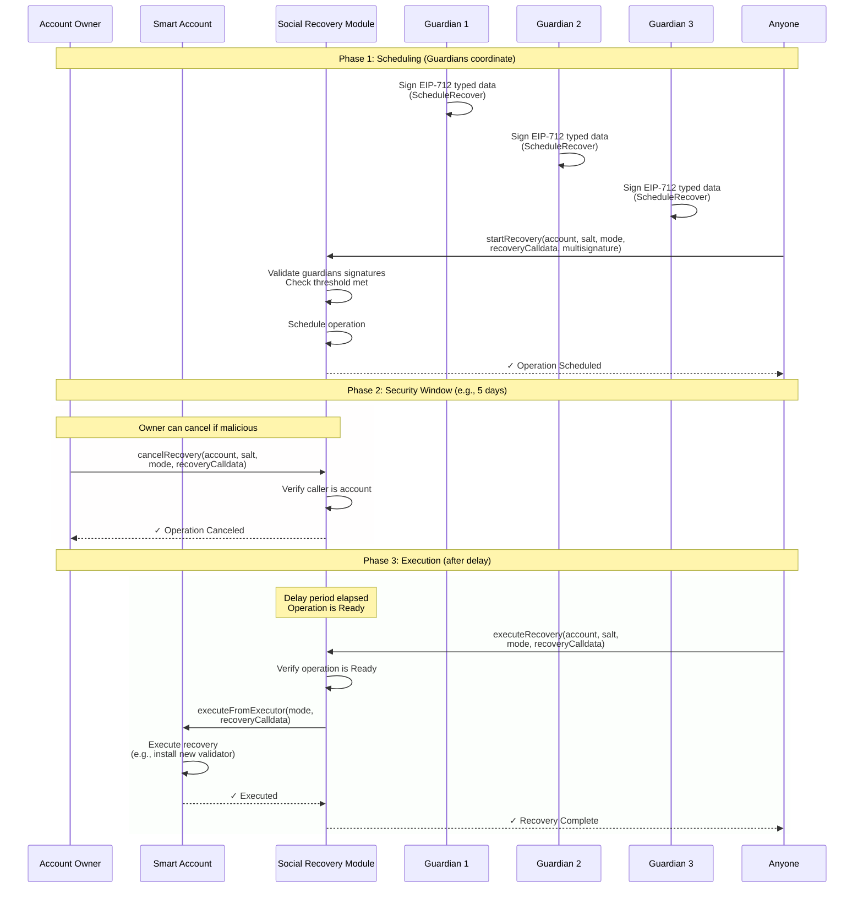

import { Step, Steps } from 'fumadocs-ui/components/steps';

Social recovery enables users to regain control of their smart accounts through trusted guardians when access to primary credentials is lost. The OpenZeppelin Accounts provides a production-ready social recovery module that combines weighted multisignatures with time-delayed execution, offering both flexibility and security. See also [Social Recovery use cases in Executors](/accounts/contracts/executors#erc7579socialrecoveryexecutor).

## Overview

Social recovery fundamentally combines two features:

1. **Multisignature validation**: Require multiple guardians to approve a recovery operation
2. **Execution scheme**: Define how and when approved operations execute

While you can compose these features in various ways (combining [`ERC7579Multisig`](/accounts/contracts/multisig) or [`ERC7579MultisigWeighted`](/accounts/contracts/multisig) with [`ERC7579Executor`](/accounts/contracts/executors#base-executor), [`ERC7579DelayedExecutor`](/accounts/contracts/executors#erc7579delayedexecutor), or even `ERC7579Validator` for ERC-4337-based execution), **`ERC7579SocialRecoveryExecutor`** is the recommended implementation, with the following features:

- Uses [`ERC7579MultisigWeighted`](/accounts/contracts/multisig) to implement a weighted list of guardians
- Uses [`ERC7579DelayedExecutor`](/accounts/contracts/executors#erc7579delayedexecutor) to enforce a security window in which the recovery operations can be cancelled
- Defines an EIP-712 type that needs to be signed using the account's domain by the account guardians
- Allows executing arbitrary calldata from the account

The module is implemented as an **executor**, rather than as a validator as specified in [ERC-7579](https://eips.ethereum.org/EIPS/eip-7579). [Executors](/accounts/contracts/executors) allow delayed and flexible execution, whereas a validator would execute through the ERC-4337 entrypoint requiring either 2 user operations or an external `queue` call (or similar) validator to support a cancellation window and wouldn't allow to customize the EIP-712 message that guardians authorize.



### Weighted Guardians

Unlike simple threshold-based multisigs (N-of-M), [weighted multisigs](/accounts/contracts/multisig#weighted-multisig-details) may support more sophisticated recovery setups. For example, social recovery could involve not only your friends and family but also other multisig. A recovery setup in which an external multisig has the same weight as 3 of your friends or 2 members of your family would be a valid configuration.

### Delayed Execution

A valid concern when setting up a social recovery mechanism is that guardians may collude maliciously or get compromised, in which case the legitimate owner of the account must be able to intervene. Using a 2-step configuration to execute a recovery action on the account provides a security window in which the owner can react. See the [operation lifecycle](/accounts/contracts/executors#erc7579delayedexecutor) for details on operation states.

<Callout>
  The owner of the account must monitor the social recovery module periodically to detect unauthorized schedule
  operations.
</Callout>

### EIP-712 Authorization

To preserve readability during recovery authorization, the executor module defines an EIP-712 type to start and cancel a recovery operation and uses the account's domain following [ERC-5267](https://eips.ethereum.org/EIPS/eip-5267). Guardians would see a request to sign a typed `StartRecovery` (or `CancelRecovery`) where the application is the account where the recovery will be executed.

<Callout>
  The module assumes that 1) accounts define an EIP-712 domain and 2) they expose it following
  [ERC-5267](https://eips.ethereum.org/EIPS/eip-5267).
</Callout>

### Arbitrary Calldata

Ideally, all accounts would implement a unified interface for recovery, however, most production-level smart accounts are already deployed and follow different schemes to set and reset the owner. In the case of ERC-7579 accounts one would argue that a recovery operation consists of adding a new validator module and optionally removing old ones, but in practice, recovery may be a call from the account to a validator to reset their key or replace signers.

From a security standpoint, the benefits of a unified interface for recovery don't see to change dramatically. In any case, the guardians are still able to change the owner and start controlling the account themselves. The diversity of ownership schemes and the lack of security benefits from a unified interface makes executing arbitrary calls from the social recovery executor the simplest approach for generalized recovery.

## Installation

To install the social recovery executor on your ERC-7579 account:

```solidity
import {MODULE_TYPE_EXECUTOR} from "@openzeppelin/contracts/interfaces/draft-IERC7579.sol";
import {ERC7579SocialRecoveryExecutor} from "@openzeppelin-accounts/contracts/modules/executors/ERC7579SocialRecoveryExecutor.sol";

// Deploy the executor (singleton, can be reused)
ERC7579SocialRecoveryExecutor socialRecovery = new ERC7579SocialRecoveryExecutor();

// Configure delay and expiration (executor settings)
uint32 delay = 5 days;      // Time before recovery can execute
uint32 expiration = 60 days; // Time after which scheduled operations expire
bytes memory executorArgs = abi.encodePacked(delay, expiration);

// Configure guardians and threshold (multisig settings)
bytes[] memory guardians = new bytes[](3);
guardians[0] = abi.encodePacked(trustedFriend1);
guardians[1] = abi.encodePacked(trustedFriend2);
guardians[2] = abi.encodePacked(familyMember);

uint64 threshold = 3; // All 3 guardians must approve

uint64[] memory weights = new uint64[](3);
weights[0] = 1; // Friend 1
weights[1] = 1; // Friend 2
weights[2] = 1; // Family member

bytes memory multisigArgs = abi.encode(guardians, threshold, weights);

// Combine both configurations
bytes memory initData = abi.concat(
    bytes2(uint16(executorArgs.length)), executorArgs,
    bytes2(uint16(multisigArgs.length)), multisigArgs
);

// Install the module
account.installModule(MODULE_TYPE_EXECUTOR, address(socialRecovery), initData);
```

## Configuration

### Managing Guardians

Guardians are represented as [ERC-7913](https://eips.ethereum.org/EIPS/eip-7913) signers (see [ERC-7913](/accounts/contracts/erc7913) for details). This allows mixing traditional EOAs with modern signature schemes like P256, WebAuthn, or ZKEmail. After installation, you can manage guardians dynamically:

```solidity
// Add new guardians
bytes[] memory newGuardians = new bytes[](1);
newGuardians[0] = abi.encodePacked(newGuardianAddress);
multisig.addGuardians(newGuardians);

// Remove guardians
bytes[] memory oldGuardians = new bytes[](1);
oldGuardians[0] = abi.encodePacked(oldGuardianAddress);
multisig.removeGuardians(oldGuardians);

// Update threshold (must remain reachable)
multisig.setThreshold(4); // Now requires 4-of-N signatures

// Update guardian weights
bytes[] memory guardians = new bytes[](1);
guardians[0] = abi.encodePacked(multisig);
uint64[] memory weights = new uint64[](1);
weights[0] = 5; // Increase external multisig weight to 5
socialRecovery.setSignerWeights(guardians, weights);
```

<Callout>
  The threshold must always be reachable with the current number of guardians. Removing guardians will fail if it would
  make the threshold unreachable.
</Callout>

To query guardians:

```solidity
// Get all guardians (paginated)
bytes[] memory allGuardians = socialRecovery.getGuardians(account, 0, type(uint64).max);

// Check if someone is a guardian
bool isGuardian = socialRecovery.isGuardian(account, guardianSigner);

// Get guardian count
uint256 count = socialRecovery.getGuardianCount(account);

// Get guardian weight
uint64 weight = socialRecovery.signerWeight(account, guardianSigner);

// Get total weight and threshold
uint64 total = socialRecovery.totalWeight(account);
uint64 threshold = socialRecovery.threshold(account);
```

### Updating Delay and Expiration

Accounts can adjust their recovery timing parameters:

```solidity
// Update delay (takes effect after transition period)
socialRecovery.setDelay(7 days); // Increase security window to 7 days

// Update expiration
socialRecovery.setExpiration(90 days); // Extend operation lifetime to 90 days
```

<Callout type="warning">
  Delay changes do not take effect immediately. The transition period depends on the direction of the change:

  - **Increasing** the delay: takes effect after `min(newDelay, delayChangeWindow())` (5 days by default). When the new delay is below `delayChangeWindow()`, the transition period is the new delay itself; very large ones are capped at `delayChangeWindow()` to guard against accidental lock-out.
  - **Decreasing** the delay: takes effect after `currentDelay - newDelay`. This ensures no already-scheduled operation can execute under a shorter security window than was active when the change was requested.
</Callout>

Query current and pending delays:

```solidity
(uint32 currentDelay, uint32 pendingDelay, uint48 effectTime) =
    socialRecovery.getDelay(account);

uint32 currentExpiration = socialRecovery.getExpiration(account);
```

## Recovery Process

The recovery process consists of three phases: [scheduling, execution, and optional cancellation](/accounts/contracts/executors#erc7579delayedexecutor).

<Steps>
<Step>
### Scheduling Recovery

Guardians must coordinate off-chain to sign an EIP-712 typed data message, then anyone can submit the multisignature to schedule the recovery:

```solidity
// Define the recovery operation (arbitrary calldata to execute on the account)
// Example: Install a new validator module to regain access
bytes memory recoveryCalldata = abi.encodeCall(
    account.installModule,
    (MODULE_TYPE_VALIDATOR, newValidatorAddress, newValidatorInitData)
);

// Guardians sign off-chain using EIP-712 typed data:
// - Domain: account's EIP-712 domain
// - Type: ScheduleRecover(bytes32 salt, bytes32 mode, bytes recoveryCalldata)
// - Values: random salt, execution mode, recovery calldata

// The multisignature is automatically sorted and encoded by guardian wallets
// See: /accounts/contracts/multisig#signature-format
bytes memory multisignature = /* ... guardian signatures ... */;

// Submit the recovery operation
socialRecovery.startRecovery(
    accountAddress,
    salt,
    mode,
    recoveryCalldata,
    multisignature
);
```

<Callout>See [multisignature format](/accounts/contracts/multisig#signature-format)</Callout>

The operation enters the **Scheduled** state and cannot execute until the delay period elapses.

</Step>

<Step>
### Executing Recovery

After the delay period passes, anyone can execute the recovery:

```solidity
// Wait for delay to elapse (e.g., 5 days)
// Then anyone can execute:

socialRecovery.executeRecovery(
    accountAddress,
    salt,
    mode,
    recoveryCalldata
);
```

The operation transitions to **Executed** state and the account's `executeFromExecutor` function is called with the recovery calldata.

<Callout type="info">
  Recovery operations expire if not executed within the expiration period (e.g., 60 days after becoming ready). Expired
  operations must be rescheduled with a different salt.
</Callout>
</Step>

<Step>
### Canceling Recovery (Optional)

The legitimate account owner can cancel malicious or erroneous recovery operations during the delay period:

```solidity
// Called by the account itself
socialRecovery.cancelRecovery(
    accountAddress,
    salt,
    mode,
    recoveryCalldata
);
```

Guardians can also coordinate to cancel recovery by signing a cancellation message:

```solidity
// Guardians sign off-chain using EIP-712 typed data:
// - Type: CancelRecover(bytes32 salt, bytes32 mode, bytes recoveryCalldata)

bytes memory cancelMultisignature = /* ... guardian signatures ... */;

socialRecovery.cancelRecovery(
    accountAddress,
    salt,
    mode,
    recoveryCalldata,
    cancelMultisignature
);
```

Canceled operations cannot be executed and enter the **Canceled** state permanently.

</Step>
</Steps>
