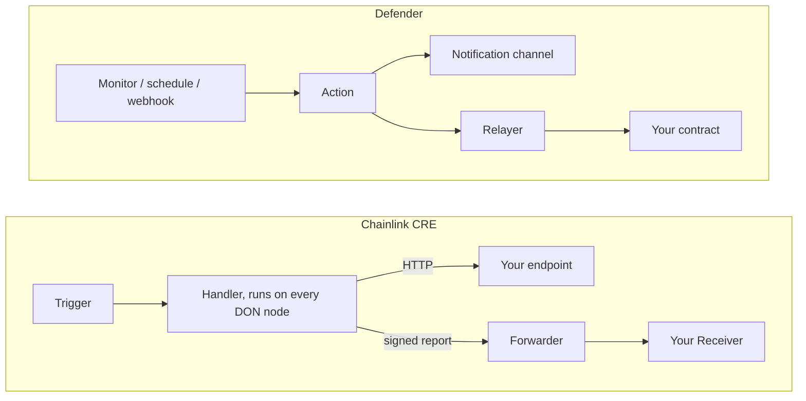

This guide has two parts. Part 1 (this page) maps each kind of Defender Setup to Chainlink CRE and explains what changes when you move it. [Part 2](/chainlink-cre/worked-example) walks through a complete port of OpenZeppelin's Defender governance alert that you simulate, deploy, and verify on Sepolia.

<a id="what-this-guide-covers"></a>
## 01 What This Guide Covers

Defender has been shut down. This guide is for teams that ran Defender Monitors, Actions, and Relayers and want to move supported workflows to [Chainlink Runtime Environment (CRE)](https://docs.chain.link/cre). Each section explains what moves into CRE and what you need to adapt, so start with the routing table and then follow the sections relevant to your workflow:

- [**Section 02**](#assessing-whether-your-use-case-transfers) maps each kind of Defender setup to a CRE pattern, or flags it for more assessment.
- [**Section 03**](#how-a-cre-workflow-runs) explains the CRE model that [sections 04–08](#scheduled-jobs) build on.
- [**Sections 04–08**](#scheduled-jobs) cover what changes for scheduled jobs, webhooks and notifications, event monitoring, onchain writes, and your existing Action code.
- [**Section 09**](#additional-migration-considerations) covers requirements these patterns do not handle.

**This is a manual port, which means that you keep your application logic but adapt triggers, runtime dependencies, and permissions. Some Defender configurations have no direct equivalent in the patterns covered here.**



*Before and after: in Defender, a Monitor, schedule, or webhook started an Action, which notified through a managed channel or had a Relayer submit a transaction. In CRE, a trigger starts a handler on every DON node, which calls your endpoint over HTTP or writes a signed report that the Forwarder verifies and delivers to your Receiver.*

<a id="assessing-whether-your-use-case-transfers"></a>
## 02 Assessing Whether Your Use Case Transfers

**Review how your workflow starts, what its code does, and what it changes.** Check every row that applies. If a Monitor invoked an Action, assess the Monitor's conditions and the Action's code together.

| **Your Defender setup** | **CRE approach** | **Read** |
| --- | --- | --- |
| Runs on a schedule (Action) | Cron trigger with your workflow logic. | [04](#scheduled-jobs) |
| Starts from a webhook (Action) | HTTP trigger; adapt the caller's authentication and payload. | [05](#offchain-actions) |
| Reacts to contract events (Monitor → Action) | EVM Log trigger; conditions become filtering logic in the handler. | [06](#monitoring-triggered-responses) |
| Sends notifications or calls an API (Monitor → Action) | HTTP requests from your code, with your own credentials and delivery handling. | [05](#offchain-actions) |
| Sends transactions (Action → Relayer) | Report-based writes through a Receiver contract. | [07](#onchain-actions) |
| Runs custom Action code (Actions) | Adapt the code and its dependencies to the CRE runtime. | [08](#porting-your-existing-code) |

These patterns are starting points. Other monitoring conditions, state across executions, and timing requirements may need additional parts or a different approach. Details on what to evaluate are in [section 09](#additional-migration-considerations) (Additional Migration Considerations). Check [supported networks](https://docs.chain.link/cre/supported-networks-ts) and [service quotas](https://docs.chain.link/cre/service-quotas) before implementing your port.

<a id="how-a-cre-workflow-runs"></a>
## 03 How a CRE Workflow Runs

[Sections 04–08](#scheduled-jobs) all build on one model: a trigger, a handler, and one of two outputs, an HTTP request or a signed report.


*A notification-only workflow needs no Receiver. For onchain writes, your Receiver can perform the operation itself or call another contract.*

A CRE workflow has three parts. A trigger starts it: a schedule, a contract event, or an HTTP request. A handler runs your logic. The handler calls capabilities: read a chain, call an API, write a report. You write the workflow in TypeScript or Go and compile it to WebAssembly. Our examples use TypeScript.

A deployed workflow runs on a [Decentralized Oracle Network (DON)](https://docs.chain.link/cre/key-terms#decentralized-oracle-network-don). CRE coordinates execution across that network and uses consensus to combine results. Running on the DON also constrains how you write the handler; [section 08](#porting-your-existing-code) covers how.

In Defender, your Action asked a Relayer to sign and submit a transaction. For onchain writes, the CRE workflow prepares a **report**: encoded data signed by the oracle network. Chainlink's [Forwarder](https://docs.chain.link/cre/guides/workflow/using-evm-client/onchain-write/building-consumer-contracts#1-core-concepts-the-onchain-data-flow) is an onchain contract that verifies those signatures and delivers the report to your **Receiver** through a function called `onReport`. The Receiver interprets the data and performs the permitted operation.

Chainlink deploys and operates the Forwarder. **The Receiver is yours: either your existing contract extended to accept reports, or a small contract in front of it.** [Section 07](#onchain-actions) covers what you write and what you configure.

<a id="scheduled-jobs"></a>
## 04 Scheduled Jobs

A scheduled Action becomes a [Cron trigger](https://docs.chain.link/cre/guides/workflow/using-triggers/cron-trigger-ts) and a handler. The expression takes the usual five fields, or six when you need seconds, and runs in UTC unless you prefix a zone, for example `TZ=America/New_York 0 9 * * 1-5`. The shortest interval is 30 seconds, per [Chainlink's quotas](https://docs.chain.link/cre/service-quotas#cron-trigger).

Inside the handler, take the time from `runtime.now()` rather than `Date.now()`. It returns [DON Time](https://docs.chain.link/cre/guides/workflow/time-in-workflows-ts), a timestamp every node agrees on.

Registering the trigger is one call:

```typescript
export function initWorkflow(config: Config) {
  const cron = new cre.capabilities.CronCapability()
  return [cre.handler(cron.trigger({ schedule: config.schedule }), onCronTrigger)]
}
```

The `schedule` value belongs in configuration; `onCronTrigger` contains the business logic. Chainlink's [keeper-bot starter template](https://github.com/smartcontractkit/cre-templates/tree/d0223f31182c76bc36b1cc9d47b13b18efcf2bf6/starter-templates/keeper-bot/keeper-bot-ts) follows a common Defender pattern, a scheduled Action that checked a contract and sent a transaction only when work was due: its handler reads the contract, checks the condition, then either skips or writes.

<details>
<summary>Show the handler excerpt (adapted, with client setup and logging removed)</summary>

```typescript
// excerpt: onCronTrigger in the keeper example
const upkeepNeeded = keeper.needsUpkeep(runtime)   // read the contract

if (!upkeepNeeded) {                                // check the condition
  return 'Skipped: no upkeep needed'
}

const reportData = encodeAbiParameters(parseAbiParameters('bool shouldExecute'), [true])
const writeResult = keeper.writeReport(runtime, reportData)   // write
```

</details>

[Section 07](#onchain-actions) covers what happens after `writeReport` and how to check its result; the full handler is [`my-workflow/workflow.ts`](https://github.com/smartcontractkit/cre-templates/blob/d0223f31182c76bc36b1cc9d47b13b18efcf2bf6/starter-templates/keeper-bot/keeper-bot-ts/my-workflow/workflow.ts) in that template.

**Keep the schedule and the execution condition separate when you port your Action, the way the template does.** Exercise both outcomes, skip and write, in simulation before you deploy.

Know where that condition is enforced. The workflow decides whether to write by reading `needsUpkeep()` on the contract, but the template's Receiver does not recheck the interval when it processes the report, so nothing onchain enforces the interval on each write. If you need that guarantee, the Receiver has to implement it.

<a id="offchain-actions"></a>
## 05 Offchain Actions

**Incoming requests.** A webhook Action becomes an [HTTP trigger](https://docs.chain.link/cre/guides/workflow/using-triggers/http-trigger/overview-ts). A deployed workflow only accepts requests signed by keys you list in `authorizedKeys`, so the caller changes along with the URL.

**Outgoing requests.** Replace managed notification settings with an HTTP integration. Define the destination, payload, credentials, and response handling. The `HTTPClient` capability coordinates requests and response aggregation across nodes.

Use Chainlink's [cacheSettings pattern](https://docs.chain.link/cre/guides/workflow/using-http-client/post-request-ts) to reduce duplicate requests across nodes. **Caching is best effort, so the destination must still enforce idempotency, including when multiple requests originate from the same workflow execution.** Treat unsuccessful HTTP responses as explicit failures. Chainlink's guide shows the fields `readFromCache` and `maxAgeMs`, while the SDK 1.19.1 `CacheSettings` type uses `store` and `maxAge`, as in this request from OpenZeppelin's `gov-alert` example, the governance alert ported in Part 2.

<details>
<summary>Show the request excerpt from `gov-alert/workflow.ts`</summary>

`sender`, `input`, and the encoded body are supplied by the surrounding implementation:

```typescript
const response = sender.sendRequest({
  method: 'POST',
  url: input.url,
  body: bytesToBase64(bodyBytes),
  headers: { 'Content-Type': 'application/json', 'Idempotency-Key': input.idempotencyKey },
  cacheSettings: { store: true, maxAge: '60s' }, // field names as of SDK 1.19.1
}).result()
if (!ok(response)) throw new Error(`HTTP request failed with status: ${response.statusCode}`)
```

</details>

The `gov-alert` example sends an `Idempotency-Key` header built from the network, the transaction hash, and the event log index supplied by CRE, so the same event always produces the same key. Many APIs support this convention for recognizing a repeated request, but HTTP does not require it and CRE does not handle it for you. The key prevents duplicate notifications only if the destination refuses a key it has already seen; if your provider does not, add your own deduplication layer or accept that limit. It also does not recover missed deliveries: if missed notifications must be recovered, define and test a retry or reconciliation process.

Whichever destination you use, you now integrate with its provider directly. Most of the channels Defender managed for you expose a webhook or an API you can call this way; email normally needs a mail provider in front of it.

**Credentials.** Secrets belong in [CRE's secrets store](https://docs.chain.link/cre/guides/workflow/secrets/using-secrets-deployed), outside your source and your config file. You create the secret once with the CLI, and the deployed workflow reads it at runtime. Follow the [`cre secrets` CLI reference](https://docs.chain.link/cre/reference/cli/secrets#authorization-flow) for the commands and the authorization step.

<a id="monitoring-triggered-responses"></a>
## 06 Monitoring-Triggered Responses

A Monitor with an event condition maps to the [EVM Log trigger](https://docs.chain.link/cre/guides/workflow/using-triggers/evm-log-trigger-ts). The trigger filters by contract address and event topics, within [Chainlink's limits](https://docs.chain.link/cre/service-quotas#evm-log-trigger) on both. **Anything Defender expressed as a condition on the decoded fields moves into the handler as plain TypeScript.** Defender evaluated those conditions with [math.js](https://mathjs.org/docs/expressions/syntax.html#differences-from-javascript), a JavaScript library for evaluating mathematical expressions, so when you translate a condition, review its operators and how it treats numbers rather than assuming TypeScript will behave the same way.

For a condition on decoded fields, evaluate the predicate before calling the notification logic. Preserve the original units, numeric precision and boundary comparisons. Test a matching event and a non-matching event, including values exactly at the threshold.

Suppose your Defender Monitor watched a [Governor](/contracts/5.x/governance) contract for new proposals. A successful proposal transaction causes that contract to emit `ProposalCreated`. In CRE you select the network and the Governor address, then register a handler for that event. The sequence runs end to end like this: the Governor emits the event onchain, a filter on address and event selects it, your handler receives it decoded, and your code turns it into a message.

The `gov-alert` example, ported in full in Part 2, ships a generated TypeScript **binding**: a helper built from the contract's ABI. The binding supplies the event filter and the decoding code, so you do not hand-write either. `logTriggerProposalCreated()` *creates the filter*; it does not create a proposal or emit an event. The event comes from the contract, and the workflow only listens for it.

Two lines from the example's `initWorkflow` in `gov-alert/workflow.ts` carry the whole mechanism: `evmClient` selects the configured network, and the address is the Governor you want to watch. The handler then receives the decoded event and passes the fields it cares about to the formatter.

<details>
<summary>Show the trigger registration and the handler (excerpts from `gov-alert/workflow.ts`)</summary>

```typescript
const governor = new GovernorEvents(evmClient, config.governorAddress as Address)

return [
  cre.handler(governor.logTriggerProposalCreated(), onProposalCreated),
]
```

```typescript
export const onProposalCreated = (
  runtime: Runtime<Config>,
  payload: DecodedLog<ProposalCreatedDecoded>,
): string =>
  handleEvent(runtime, payload, {
    type: 'ProposalCreated',
    proposalId: payload.data.proposalId,
    proposer: payload.data.proposer,
    description: payload.data.description,
  })
```

</details>

The full example registers four more Governor events the same way, each with its own small handler and all sharing one formatter.

In this design, two matching events in the same transaction arrive as two executions, where Defender delivered one payload with both. If your Action relied on that batching, restructure it. For conditions on function calls or transaction status, see the options in [section 09](#additional-migration-considerations).

<a id="onchain-actions"></a>
## 07 Onchain Actions

Porting an Action that sent transactions through a Relayer mostly means work on the receiving end. Your application logic and your contracts still exist. What changes is delivery: a Relayer simply submitted the transaction your Action had already composed, while CRE delivers a signed report, so you may need to add a contract able to accept that report and act on it. Depending on what you own, that can mean extending a contract you already have rather than deploying a new one.

To accept a report, a contract has to say so. That is all the [IReceiver standard](https://docs.chain.link/cre/guides/workflow/using-evm-client/onchain-write/building-consumer-contracts#2-the-ireceiver-standard) is: `onReport`, plus [ERC-165 interface detection](/contracts/5.x/utilities#introspection) so the Forwarder can check compatibility before calling. You can implement it directly, or inherit Chainlink's [`ReceiverTemplate`](https://docs.chain.link/cre/guides/workflow/using-evm-client/onchain-write/building-consumer-contracts#3-using-receivertemplate), which handles report reception and configured source-identity checks and leaves you `_processReport` to fill in; your implementation defines which operations and arguments are allowed.

Then you choose where it sits, and Chainlink's guide gives [a worked example of each shape](https://docs.chain.link/cre/guides/workflow/using-evm-client/onchain-write/building-consumer-contracts#6-complete-examples). Either your target contract becomes the Receiver itself, [the simple consumer](https://docs.chain.link/cre/guides/workflow/using-evm-client/onchain-write/building-consumer-contracts#example-1-simple-consumer-contract), or a **receiver adapter** sits in front, accepts the report and calls the target, which Chainlink documents as [the proxy pattern](https://docs.chain.link/cre/guides/workflow/using-evm-client/onchain-write/building-consumer-contracts#example-2-the-proxy-pattern). It forwards calls and has nothing to do with an [upgradeability proxy](/contracts/5.x/api/proxy). The adapter is what you want when the target already exposes the operation you need and can authorize another caller.


*The receiving design determines which address your contract must authorize.*

| **Receiving design** | **Caller seen by the contract** |
| --- | --- |
| Target implements `IReceiver` | The target's `onReport` sees the Forwarder |
| A receiver adapter receives the report and calls the target | The adapter sees the Forwarder; the target sees the adapter |

This matters because a target that checks `msg.sender` will see a different address than it used to. For a protected target behind an adapter, grant the adapter the required permission (see [Access Control](/contracts/5.x/access-control) for `Ownable` and `AccessControl` targets). Review the permissions wherever a contract accepted calls from your old Relayer address: some can be updated in place, and a contract locked to that address may need a replacement or a different integration.

Then configure who may deliver, and configure both halves. One is the Forwarder address your Receiver trusts. The other is the identity of the workflow whose reports you accept, because trusting a Forwarder on its own accepts every CRE workflow that can deliver through it, not only yours. In `ReceiverTemplate` those are the [permission setters](https://docs.chain.link/cre/guides/workflow/using-evm-client/onchain-write/building-consumer-contracts#34-configuring-permissions): `setExpectedWorkflowId`, or `setExpectedAuthor` together with `setExpectedWorkflowName`. Take the Forwarder address from the [directory and its instructions](https://docs.chain.link/cre/guides/workflow/using-evm-client/forwarder-directory-ts) for the network and environment you are targeting, rather than assuming one address per chain; after logging in, `cre workflow supported-chains` lists the addresses available to you.

<Callout type="warn">

A Receiver that trusts the right Forwarder but no workflow identity is open to anyone else's workflow.

</Callout>

Configure these checks before accepting deployed reports. For mock-Forwarder simulation, use an isolated test Receiver and follow the [documented metadata limitations](https://docs.chain.link/cre/guides/workflow/using-evm-client/onchain-write/building-consumer-contracts#4-working-with-simulation); do not weaken the permissions on your deployed Receiver to make a simulation pass.

The Forwarder does not redeliver a report that already succeeded. Some failed attempts can be retried, but not all: a transmission recorded as having an invalid receiver is also treated as already attempted. And two reports with the same content are still two calls. Keep the operation idempotent in the Receiver rather than relying on delivery behavior, and follow Chainlink's guidance on [binding reports to the intended chain](https://docs.chain.link/cre/guides/workflow/using-evm-client/onchain-write/building-consumer-contracts#replay-attacks).

On the workflow side, the write is one call on the generated `KeeperConsumer` binding in Chainlink's keeper-bot starter template ([section 04](#scheduled-jobs)). The report encodes a boolean execution signal, and the Receiver decodes it and increments a counter. This example illustrates the write path only; the governance walkthrough in Part 2 is a separate, notification-only workflow.

<details>
<summary>Show the write and its two status checks (adapted from the template's `workflow.ts`, with shorter error messages)</summary>

```typescript
const writeResult = keeper.writeReport(runtime, reportData)
if (writeResult.txStatus !== TxStatus.SUCCESS) {
  throw new Error(writeResult.errorMessage || String(writeResult.txStatus))
}
if (
  writeResult.receiverContractExecutionStatus !== undefined &&
  writeResult.receiverContractExecutionStatus !== 0
) {
  throw new Error('Receiver contract execution failed')
}
```

</details>

The above code checks the transaction status and the reported Receiver execution status. Neither proves the operation did what you meant. After a deployed write or an explicitly broadcast simulation, read the contract to verify the intended state change; a normal dry-run simulation does not change onchain state.

One deployment detail catches people out: if a read of a Receiver you just deployed fails to decode empty data, the read probably targeted a finalized block from before the deployment, so wait for finality to advance. Check the network, the address and the ABI too, since they cause the same error.

<a id="porting-your-existing-code"></a>
## 08 Porting Your Existing Code

Three things change for the Action code itself: the runtime it runs in, the contract bindings you generate, and the requirement that every node reach the same result.

### Runtime and Dependencies

Action code ran on Node.js. CRE packages the JavaScript generated from your TypeScript together with [QuickJS](https://docs.chain.link/cre/concepts/typescript-wasm-runtime) into a WebAssembly binary, so Node.js APIs may need replacements. Check both the language features and the platform APIs your code uses, because the gap is not obvious from reading it. With CRE CLI 1.34.0 and `@chainlink/cre-sdk` 1.19.1, `Intl` was unavailable and `structuredClone` was undefined, which is enough to break number or date formatting that worked fine in an Action. For hex conversion, use the SDK's `bytesToHex`. Availability is a property of the runtime version, so check it against the one you deploy on rather than trusting this list.

### Generated Bindings

Generated bindings have one sharp edge worth checking early. In CRE CLI 1.34.0, a contract with overloaded functions produced bindings that do not compile, and OpenZeppelin's Governor is such a contract. The `gov-alert` example sidesteps it by generating from an events-only ABI; reducing an ABI does not help if the functions you keep are still overloaded.

### Deterministic Execution and Simulation

[Determinism](https://docs.chain.link/cre/concepts/non-determinism-ts) is the largest of the three changes, and it has no Defender equivalent because an Action ran once, on one machine. **Here every node runs your handler and they have to arrive at the same answer.** Anything that can differ per node breaks that when it influences execution: `Math.random()`, `Date.now()`, and any branch, record selection, call or loop count that depends on them. Take time from `runtime.now()` instead.

Work that genuinely cannot agree by itself, such as calling a third-party API, goes in a different execution mode. The SDK names the two after its runtime types: your handler receives a `Runtime`, [which the reference calls DON mode](https://docs.chain.link/cre/reference/sdk/core-ts#runtime-and-noderuntime), and you drop into Node mode inside `runtime.runInNodeMode()`, where each node produces its own answer and you supply the [rule that combines them](https://docs.chain.link/cre/reference/sdk/consensus-ts).

Be careful with what local simulation proves. It runs on a [single node](https://docs.chain.link/cre/guides/operations/simulating-workflows#limitations), so by construction it cannot detect disagreement between nodes: a workflow can pass local simulation even when node-dependent values affect decisions or outputs that must agree across the DON. A green local run tells you the code executes; whether the DON will agree on the result is a separate question, so review the decision logic for determinism by reading it.

A practical starting point is to separate pure formatting and calculations from network calls. Test the pure functions with the same inputs used by the Defender Action. Then adapt network access to CRE capabilities and review every value that controls a branch or an operation.

Finally, keep credentials in CRE's secrets store, as set up in [section 05](#offchain-actions), rather than in committed configuration or source code.

<a id="additional-migration-considerations"></a>
## 09 Additional Migration Considerations

Some requirements need more than the patterns in [sections 04–08](#scheduled-jobs). **Assess the behavior you need to preserve before adding parts.**

- **Conditions on function calls or transaction status**: an EVM Log trigger covers emitted events. For other signals, consider an external event source that invokes the HTTP trigger. Periodic chain reads may suit state-based checks, but can miss intermediate activity and do not reproduce every transaction condition.
- **State across executions**: alert thresholds and cooldowns depend on history. External storage may hold that history, but the design must account for concurrent executions, retries and duplicate updates. A read followed by a write is not automatically sufficient.
- **Schedules under 30 seconds**: the current [Cron quota](https://docs.chain.link/cre/service-quotas#cron-trigger) has a 30-second floor. Check whether the task tolerates that interval or can react to an event instead. An HTTP trigger has its own rate limit, so it cannot work around that floor.

Treat these as options to evaluate; this guide has not validated them as implementations. Event-driven execution also has quotas and does not promise a particular response time. If the original timing or monitoring behavior is essential, confirm that the chosen design preserves it before porting the remaining logic.

For managed notification channels, use the HTTP integration described in [section 05](#offchain-actions). Other configurations not covered here need individual assessments. Send questions to Defender support: [defender-support@openzeppelin.com](mailto:defender-support@openzeppelin.com).

<a id="next-try-it-end-to-end"></a>
## Next: Try It End to End

By now you should know which CRE pattern each of your Defender setups maps to, what to adapt in each, and which ones need their own assessment. Part 2 puts sections [03](#how-a-cre-workflow-runs), [05](#offchain-actions), [06](#monitoring-triggered-responses) and [08](#porting-your-existing-code) into practice with a notification-only workflow: it ports OpenZeppelin's Defender governance alert to CRE, replays a real proposal through local simulation, deploys the workflow on Sepolia, and checks both a successful delivery and a failed one. It has no Cron trigger or Receiver, so sections [04](#scheduled-jobs) and [07](#onchain-actions) stay your reference for those.

**Continue to Part 2:** [Worked Example](/chainlink-cre/worked-example)

<a id="glossary"></a>
## Glossary

<details>
<summary>Show the glossary</summary>

- [**Trigger**](https://docs.chain.link/cre/guides/workflow/using-triggers/overview)**.** What starts a workflow: a cron schedule, an EVM log, or an HTTP request.
- [**Handler**](https://docs.chain.link/cre/reference/sdk/core-ts#handler)**.** The function that runs when a trigger fires.
- [**DON**](https://docs.chain.link/cre/key-terms#decentralized-oracle-network-don)**.** Decentralized Oracle Network. The nodes that run your workflow and agree on the result.
- [**DON mode and Node mode**](https://docs.chain.link/cre/reference/sdk/core-ts#runtime-and-noderuntime)**.** Two execution modes, named in the SDK reference after the two runtime types. DON mode is the `Runtime` your handler receives, for operations the network already guarantees. Node mode is the `NodeRuntime` you get inside `runtime.runInNodeMode()`, where nodes may differ and you supply the [aggregation rule](https://docs.chain.link/cre/reference/sdk/consensus-ts).
- [**Report**](https://docs.chain.link/cre/guides/workflow/using-evm-client/onchain-write/overview-ts)**.** Data prepared by a workflow and signed by the DON for delivery to your Receiver.
- [**Forwarder**](https://docs.chain.link/cre/guides/workflow/using-evm-client/onchain-write/building-consumer-contracts#1-core-concepts-the-onchain-data-flow)**.** The Chainlink contract that verifies a report's signatures and calls your Receiver. Which address applies depends on your network and environment.
- [**Receiver**](https://docs.chain.link/cre/guides/workflow/using-evm-client/onchain-write/building-consumer-contracts)**.** Your contract. It implements `onReport` and holds the logic a report may trigger.

</details>
