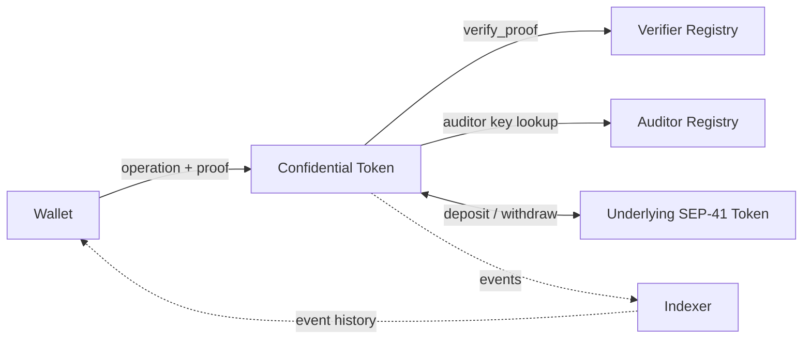

[Source Code](https://github.com/OpenZeppelin/stellar-contracts/tree/main/packages/confidential)

The Confidential Token adds private balances and transfers to any SEP-41 token. Users deposit regular tokens
into a confidential token contract, and from that point on their balances and the amounts they transfer are hidden
from the public while remaining fully verifiable by the network. Every operation that spends private state carries
a zero-knowledge proof that the contract verifies on-chain before updating any balance.

The module provides **confidentiality, not anonymity**: sender and recipient addresses stay visible on-chain,
while amounts and balances do not.

Balances are stored as Pedersen commitments on the Grumpkin curve, which the contract updates homomorphically (by
adding and replacing curve points) without ever learning the amounts behind them. Recipients and auditors recover
the amounts that concern them by decrypting ciphertexts published in the contract's events.

## Architecture

### Core Components

A deployment consists of three contracts wired together:

- **Confidential Token**: Implements the `ConfidentialToken` trait. It holds all deposited tokens in a single pooled
  balance, stores one `ConfidentialAccount` per registered address and one `SpenderDelegation` per owner-spender pair,
  and calls the verifier for every operation that requires a proof.
- **Auditor Registry**: Implements the `ConfidentialAuditor` trait and stores auditor public keys indexed by
  `auditor_id`. A single registry can serve many tokens. See [Auditing](/stellar-contracts/tokens/confidential/auditing).
- **Verifier Registry**: Implements the `ConfidentialVerifier` trait and stores one UltraHonk verification key per
  circuit. It can be shared by every token that runs the same protocol version.
  See [Proof System](/stellar-contracts/tokens/confidential/proof-system).



### Off-Chain Components

Because the contract never sees balances or confidential transfer amounts, a large part of the protocol runs on the
client:

- **Wallet**: Derives keys, generates proofs, decrypts events, and tracks the openings (value and blinding factor)
  of the account's commitments. See [Wallet Integration](/stellar-contracts/tokens/confidential/wallet-integration).
- **Indexer**: A durable archive of the contract's events, which wallets and auditors need to recover state.
  See [Indexing and Recovery](/stellar-contracts/tokens/confidential/indexing).
- **Circuits**: Six Noir circuits compiled to UltraHonk, shipped in the
  [`circuits`](https://github.com/OpenZeppelin/stellar-contracts/tree/main/packages/confidential/circuits)
  directory together with their pinned verification keys.

<Callout type="info">
The library ships the on-chain modules (traits and storage helpers), the Noir circuits, and example contracts under
[`examples/confidential`](https://github.com/OpenZeppelin/stellar-contracts/tree/main/examples/confidential): the
verifier and auditor registries, an allowlist policy, a token with the compliance extension, and a factory. The client SDK, the indexer, and the
[selective disclosure](/stellar-contracts/tokens/confidential/selective-disclosure) layer are specified in the
[protocol documentation](https://github.com/OpenZeppelin/stellar-contracts/blob/main/packages/confidential/docs/README.md)
but are not part of the library.
</Callout>

## Key Concepts

| Concept                   | Description                                                                                                                                                                                                                         |
| ------------------------- | ----------------------------------------------------------------------------------------------------------------------------------------------------------------------------------------------------------------------------------- |
| **Commitment**            | A balance stored as a single curve point `C = v·G + r·H`. The contract sees only the point; the opening `(v, r)` lives in the owner's wallet.                                                                                        |
| **Spendable balance**     | The part of an account's funds available for transfers and withdrawals. Only operations the owner authorizes modify it, apart from the [compliance extension](/stellar-contracts/tokens/confidential/clawback)'s seizure functions. |
| **Receiving balance**     | A separate accumulator where incoming deposits and transfers land.                                                                                                                                                                 |
| **Merge**                 | An owner-authorized operation that folds the receiving balance into the spendable balance. It requires no proof.                                                                                                                  |
| **Zero-knowledge proof**  | Generated by the wallet and attached to an operation. It proves the operation is valid (sufficient funds, correct balance updates, honest encryption) without revealing any amount. See [Zero-Knowledge Setting](/stellar-contracts/tokens/confidential/privacy-model#zero-knowledge-setting). |
| **Auditor**               | A key chosen by each account at registration. Every transfer (direct or by a spender), withdrawal, and spender setup produces ciphertexts that this key can decrypt.                                                          |
| **Spender**               | A registered address authorized by an owner to spend from a capped, time-limited allowance. See [Spenders](/stellar-contracts/tokens/confidential/spenders).                                                                      |

## Installation

The confidential token lives in its own crate, `stellar-confidential`, separate from `stellar-tokens`. Add it to the
contract's dependencies:

```bash
cargo add stellar-confidential
```

The contract must use a `soroban-sdk` version compatible with the one `stellar-confidential` depends on.

## Usage

Deploying a confidential token involves three steps:

1. Deploy the verifier registry and register the verification key of each circuit.
   See [Proof System](/stellar-contracts/tokens/confidential/proof-system).
2. Deploy an auditor registry, or reuse an existing one, and register at least one auditor key.
   See [Auditing](/stellar-contracts/tokens/confidential/auditing).
3. Deploy the confidential token, passing the underlying token, the verifier registry, and the auditor registry
   to its constructor.

The [testnet deployment guide](https://github.com/OpenZeppelin/stellar-contracts/blob/main/examples/confidential/README.md)
walks through these steps with the Stellar CLI and the example contracts, and also deploys an allowlist policy and
the compliance extension. [Best Practices for Administrators](/stellar-contracts/tokens/confidential/best-practices/administrators)
covers what changes for a production deployment.

Here's what a basic confidential token contract looks like:

```rust
use soroban_sdk::{contract, contractimpl, Address, Bytes, Env};
use stellar_confidential::{
    storage as confidential, ConfidentialAccount, ConfidentialToken, NoHooks, SpenderDelegation,
}; // `Bytes`, `ConfidentialAccount` and `SpenderDelegation` are used by the trait's default methods

#[contract]
pub struct ConfidentialTokenContract;

#[contractimpl]
impl ConfidentialTokenContract {
    pub fn __constructor(e: &Env, underlying_asset: Address, verifier: Address, auditor: Address) {
        // The SEP-41 token being wrapped. Set once; cannot be changed.
        confidential::set_underlying_asset(e, &underlying_asset);
        // The verifier and auditor registries.
        confidential::set_verifier(e, &verifier);
        confidential::set_auditor(e, &auditor);
        // Binds every proof to this contract's address. Set once; cannot be changed.
        confidential::set_address_as_field_element(e);
    }
}

#[contractimpl(contracttrait)]
impl ConfidentialToken for ConfidentialTokenContract {
    type Hooks = NoHooks;
    // Every entry point and read method uses the trait's default implementation.
}
```

See [Operations](/stellar-contracts/tokens/confidential/operations) for what each entry point does.

## Hooks

The `Hooks` associated type is the extension point of the token. Its callbacks run at every state-changing entry point,
after authorization and payload decoding, and before any state is modified:

- `on_register`, `on_deposit`, `on_merge`, `on_withdraw`
- `on_transfer`, `on_spender_transfer`
- `on_set_spender`, `on_revoke_spender`

Callbacks of operations that carry a payload receive the decoded payload (the proof itself is not forwarded).
Every callback has an empty default body, so an implementation overrides only what it needs, and rejects an operation
by panicking with an error.

Two implementations are provided:

- `NoHooks`: every callback is a no-op. Use it for deployments without additional controls.
- `ComplianceHooks`: account freezing, SAC authorization passthrough, and an external authorization policy.
  See [Compliance](/stellar-contracts/tokens/confidential/compliance).

For pure observability, subscribe to the token's events instead of implementing a hook.

## Underlying Token Requirements

The contract credits and debits confidential balances by the exact amount it passes to the underlying token's
`transfer`, without re-measuring its own balance. The underlying token must therefore:

- **Move exactly the requested amount**: no fee deducted in transit.
- **Not rebase**: the contract's balance changes only through transfers the contract itself initiates.
- **Revert on failure**: a failed `transfer` must revert the whole `deposit` or `withdraw`.

The Stellar Asset Contract and the OpenZeppelin [Fungible Token](/stellar-contracts/tokens/fungible/fungible) meet
these requirements. Wrapping any other token is the deployer's responsibility.

<Callout type="warning">
When the underlying token is a SAC, its issuer has two powers over the contract's pooled balance.
**Freezing or deauthorizing** the contract's address blocks every deposit and withdrawal for all holders until it
is lifted; confidential transfers between registered accounts keep working. **Clawing back** from the contract's
address removes value from the pool, leaving it holding less than the sum of all confidential balances: withdrawals
become first-come-first-served, and whoever exits last cannot fully redeem. See
[Clawback](/stellar-contracts/tokens/confidential/clawback) for how to seize funds from one account without
creating a shortfall for everyone else.
</Callout>

## Security Considerations

- **Proofs** use the non-zero-knowledge flavor of UltraHonk, the only one the on-chain verifier supports. Soundness
  is unaffected. Amount and balance privacy rests on how the circuits are built instead, and a proof lowers the
  security of the prover's long-term key from about 127 to about 100 bits. The proving recipe stays provisional
  until the zero-knowledge flavor is supported. See
  [Zero-Knowledge Setting](/stellar-contracts/tokens/confidential/privacy-model#zero-knowledge-setting).
- **Soundness** rests on the verification keys in the verifier registry matching the intended circuits. A wrong key
  makes the contract accept forged proofs. See [Proof System](/stellar-contracts/tokens/confidential/proof-system).
- **Privacy** covers amounts and balances, not addresses or timing, and some balances can be inferred from public
  flows. See [Privacy Model](/stellar-contracts/tokens/confidential/privacy-model).
- **Operations** such as key custody, backups, governance, and seizures are covered by role in the Best Practices
  for [account holders](/stellar-contracts/tokens/confidential/best-practices/account-holders),
  [administrators](/stellar-contracts/tokens/confidential/best-practices/administrators), and
  [auditors](/stellar-contracts/tokens/confidential/best-practices/auditors).

## Specification

This documentation covers what is needed to deploy and integrate the module. The normative
[protocol specification](https://github.com/OpenZeppelin/stellar-contracts/blob/main/packages/confidential/docs/README.md)
covers the cryptographic construction, every circuit constraint, and the companion specifications for compliance,
the SDK, indexing, and selective disclosure.
